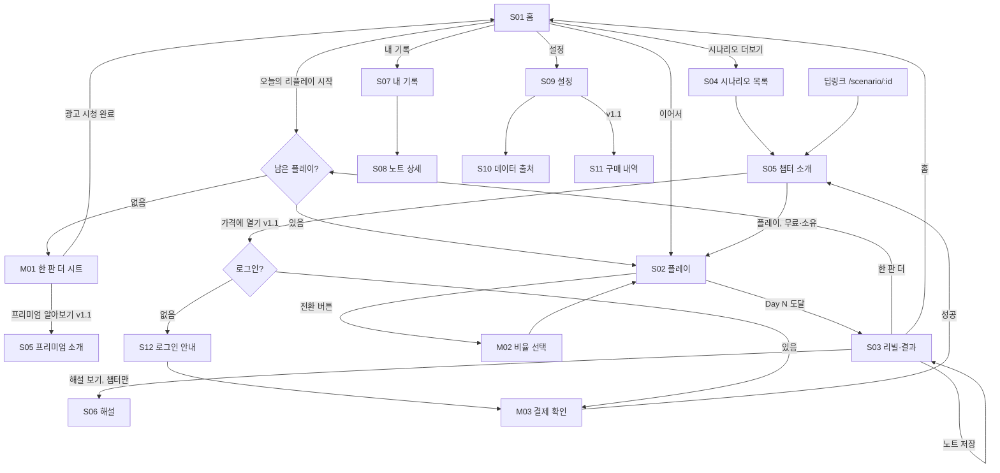

# 화면 흐름·와이어프레임 — fx-replay

| 항목 | 내용 |
|---|---|
| 문서 버전 | v0.1 (2026-09-07) |
| 상위 문서 | [FUNCTIONAL_SPEC.md](FUNCTIONAL_SPEC.md) v0.1 (화면 ID·동작 규칙), [PRD.md](PRD.md) v0.2 (문구 원칙 A·B·C) |
| 범위 | v1.0 전 화면 + v1.1 추가 화면(`[v1.1]`). 와이어프레임은 저해상도(구조·우선순위·카피)만 정의. 색·타이포는 6장 최소 토큰 |
| 기준 뷰포트 | 360×780 (안드로이드 중급기), 세이프 에어리어 상단은 앱인토스 네비게이션 바가 차지 |

---

## 1. 네비게이션 맵



### 1-1. 하단 탭

상단 네비게이션 바는 토스가 그린다. **하단 상시 이동은 미니앱이 직접 만든다**(`src/components/TabBar.tsx`).

| 탭 | 화면 | 아이콘 |
|---|---|---|
| 홈 | S01 | 집 |
| 시나리오 | S04 | 목록 |
| 기록 | S07 | 책갈피 |
| 설정 | S09 | 슬라이더 |

노트 상세(S08)는 탭을 숨긴다. 하단에 저장·삭제 CTA가 있다.

- 탭을 **숨기는 화면**: S02 플레이, S03 결과·복기, S05 챕터 소개, S06 해설, S10 데이터 출처, S11·S12. 하단에 자체 CTA가 있고 집중이 필요한 화면이다.
- 높이 56 + `env(safe-area-inset-bottom)`. `.app` 플렉스 컬럼의 마지막 자식이라 `.scroll` 과 겹치지 않는다.
- 아이콘은 인라인 SVG(외부 아이콘 라이브러리 없음). 톱니바퀴는 24px 에서 햇살처럼 보여 설정은 슬라이더 아이콘을 쓴다.
- 활성 탭은 `--primary` 색 + 굵게. `:active` 에 투명도 피드백.

뒤로가기 규칙: S01에서 뒤로가기(네비게이션 바·안드로이드 백버튼) = 미니앱 종료. S02에서 뒤로가기 = 자동 일시정지 후 "나갈까요?" 확인(세션은 보존, 홈에 "이어서" 카드). S03에서 뒤로가기 = 홈(플레이로 되돌아가지 않음). 바텀시트에서 백버튼 = 시트 닫기.

---

## 2. 공통 레이아웃 규칙

### 2-1. 앱인토스 네비게이션 바 (체크리스트 준수)
| 화면 | 좌측 | 제목 | 우측 |
|---|---|---|---|
| S01 | (없음, 닫기는 토스 공통) | 앱 로고 + "그때 환전했다면"(콘솔 등록명과 동일) | 토스 공통 더보기(⋯) |
| S02 | 뒤로가기 | "Day 12 / 60" (블라인드) 또는 "1997 외환위기 · Day 12 / 60" | 미니앱 기능 버튼 1개: 일시정지/재생 토글은 화면 내 버튼으로 두고 바에는 두지 않음 |
| S03 | 뒤로가기(→홈) | "복기" | — |
| S04~S12 | 뒤로가기 | 화면명 | — |

- 자체 뒤로가기 버튼을 화면 안에 그리지 않는다(중복 금지).
- 미니앱 기능 버튼은 사용하지 않는다(단순화).

### 2-2. 세이프 에어리어·그리드
- 좌우 여백 20, 카드 간격 12, 카드 라운드 16, 기본 터치 타깃 48.
- 하단 고정 CTA 영역 높이 72 + 홈 인디케이터 여백.
- 배너 광고: S01·S07의 **스크롤 컨텐츠 마지막 요소**로 배치(고정 아님). 높이 50~100, "Ad" 라벨은 SDK가 표기.

### 2-3. 상태 변주(모든 화면 공통)
| 상태 | 표현 |
|---|---|
| 로딩 | 스켈레톤(카드 형태 유지). 스피너 단독 화면 금지 |
| 빈 상태 | 아이콘 없이 한 문장 + 1개 CTA. 예) "아직 복기한 기록이 없어요" / [오늘의 리플레이 시작] |
| 오류 | 토스트(3초) 우선. 화면 전체 오류는 데이터 파일 로드 실패 때만: "데이터를 불러오지 못했어요. 앱을 다시 열어 주세요" |
| 오프라인 | 광고·결제 버튼에만 "인터넷 연결이 필요해요" 툴팁. 나머지는 정상 동작 |

---

## 3. 화면별 와이어프레임

표기: `[버튼]` 주요 CTA, `(보조)` 보조 버튼, `〈…〉` 동적 값, `▤` 배너, `~~~` 차트, `····` 구분선.

### S01 홈

```
┌──────────────────────────────────┐
│ ◉ 그때 환전했다면            ⋯   │  ← 앱인토스 네비게이션 바
├──────────────────────────────────┤
│ 과거 차트로 배우는 판단 복기       │  H1
│ 자산과 날짜를 가린 과거 환율을     │  본문 2줄
│ 하루씩 재생하며 선택해 보세요.     │
│                                  │
│ ┌ 진행 중인 리플레이 ───────────┐ │  (세션 있을 때만)
│ │ Day 23 / 60 · 어제 시작        │ │
│ │ [이어서 재생]      (그만두기)  │ │
│ └──────────────────────────────┘ │
│ ┌ 오늘의 리플레이 ─────────────┐ │
│ │ 무작위 과거 60거래일 · 블라인드 │ │
│ │ 오늘 남은 리플레이 〈2〉회      │ │  프리미엄: "무제한"
│ │ [리플레이 시작]                │ │
│ └──────────────────────────────┘ │
│ 시나리오                  더보기 › │
│ ┌────────┐┌────────┐┌────────┐   │  가로 스크롤 카드 3개
│ │2005    ││1997    ││2008    │   │
│ │원화 강세││외환위기 ││금융위기 │   │
│ │무료    ││곧 열려요││곧 열려요│   │  v1.1: 가격 / 소유
│ └────────┘└────────┘└────────┘   │
│ 내 기록                    전체 › │
│ ┌──────────────────────────────┐ │
│ │ 2008.09~11 · 달러로 2번 바꿈   │ │  최근 노트 1개, 없으면 빈 상태
│ └──────────────────────────────┘ │
│ ▤ 배너 광고 (스크롤 끝)           │
├──────────────────────────────────┤
│  🏠      ☰       🔖       ⚙︎      │  하단 탭 (상시)
│  홈   시나리오   기록    설정      │
└──────────────────────────────────┘
```
- 첫 진입에 시트·팝업 없음. 스크롤 컨테이너 하나.
- 설정은 하단 탭으로 간다(본문에 링크를 두지 않는다).
- "리플레이 시작" 탭 → 즉시 S02(로딩 없음, 데이터는 번들). 잔여 0이면 M01.

### S02 플레이

```
┌──────────────────────────────────┐
│ ‹  Day 〈12〉 / 60                │
├──────────────────────────────────┤
│ 자산 〈?〉            시작 대비    │  블라인드: "?" / 챕터: "원/달러 환율"
│ 〈104.2〉             〈+4.2%〉    │  정규화 값 / 챕터: 실제 값 "1,412원"
│                                  │
│  ~~~~~~~~~~~~~~~~~~~~~~~~~~~     │  캔들 차트, 높이 260
│  ~~~~~~~~~~~ 캔들 60칸 고정 ~~~~  │  x축: Day 1 · 10 · 20 … (챠터: 날짜)
│  ~~~~~~~ 미래 칸은 빈 격자 ~~~~~  │  y축: 정규화 값(블라인드) / 원(챕터)
│  ▲ 내 전환 마커(하단 점)           │
│                                  │
│ ····························     │
│ 내 포인트                        │
│ 〈1,050,000〉 P                  │  총 P, 정수
│ 원화 〈500,000〉 P · 달러 〈550,000〉 P │  달러는 현재 종가 환산 P
│ ····························     │
│ ┌────────────┐ ┌────────────┐    │
│ │ 달러로 바꾸기 │ │ 원화로 바꾸기 │    │  각 탭 → M02
│ └────────────┘ └────────────┘    │
│ (그대로 두기 = 아무 것도 안 함)     │  안내 텍스트, 버튼 아님
│                                  │
│  ⏸ 일시정지     1x | 2x          │  하단 컨트롤 바
└──────────────────────────────────┘
```
- 캔들은 2초마다 우측으로 추가, 마지막 캔들은 살짝 강조.
- 전환 버튼 비활성 조건은 명세 3-3(잔고 없음).
- 백그라운드 복귀 시 차트 위 오버레이 "일시정지됨 · [재생]".
- 뒤로가기 → 오버레이 확인: "나가면 여기서 멈춰 있어요. 홈에서 이어서 할 수 있어요." [나가기] (계속하기).
- Day 60 도달 → 컨트롤 바가 "[결과 보기]" 단일 버튼으로 바뀌고 1.5초 후 자동 전환.

### M04 사건 정지 (바텀시트, 챕터 전용)

```
┌──────────────────────────────────┐
│ 그날 있었던 일                     │
│ 2020.03.11                        │
│ WHO 팬데믹 선언                    │
│ 세계보건기구가 감염병의 세계적       │
│ 대유행을 선언했다.                  │
│ ····························     │
│ 2020.03.19                        │  같은 봉의 사건은 함께 (주·월봉)
│ 한미 통화스와프                    │
│ …                                 │
│                                  │
│ 재생이 멈춰 있어요. 바꾸거나 다시   │
│ 재생하세요.                        │
│ [확인]                            │
└──────────────────────────────────┘
```
- 사건이 걸린 봉에 도달하면 자동으로 열린다. 엔진은 `paused`.
- **[확인]은 시트만 닫고 재생을 재개하지 않는다.** 그 자리에서 전환하거나 하단 [재생]을 누른다.
- 뒤로가기는 시트만 닫는다.
- 블라인드 플레이에서는 열리지 않는다.

### M02 전환 비율 선택 (바텀시트)

```
┌──────────────────────────────────┐
│ 달러로 바꾸기                     │  또는 "원화로 바꾸기"
│ 원화 〈500,000〉 P 중 얼마를 바꿀까요?│
│ ┌──────┐ ┌──────┐ ┌──────┐       │
│ │ 25%  │ │ 50%  │ │ 전부  │       │  탭 즉시 체결 후 시트 닫힘
│ └──────┘ └──────┘ └──────┘       │
│ 바꾸는 동안 재생은 잠시 멈춰요.     │
└──────────────────────────────────┘
```
- 시트 열림 = 엔진 `paused`, 닫힘(체결 또는 취소) = `playing` 복귀.
- 체결 후 차트 하단에 전환 마커 점 추가, 토스트 없음(화면 잔고가 바뀌므로).

### S03 리빌·결과·복기

```
┌──────────────────────────────────┐
│ ‹  복기                           │
├──────────────────────────────────┤
│ 원/달러 환율                      │  리빌 애니메이션 후 확정 표시
│ 2008.09.01 ~ 2008.11.28           │
│  ~~~~~~~~~~~~~~~~~~~~~~~~~~~     │  실제 값 축, 사건 마커(◆)와
│  ~~~~◆~~~~~~~~~◆~~~~~●~~~~~~~    │  내 전환 마커(●) 겹침
│  1,100원 ······· 1,513원          │  기간 최저·최고
│                                  │
│ ┌──────────────────────────────┐ │
│ │ 결과            〈1,050,000〉 P │ │
│ │ 그대로 뒀다면     1,000,000 P │ │
│ │ 차이              〈+50,000〉 P │ │  부호·색만, 평가 문구 없음
│ └──────────────────────────────┘ │
│ 내 선택                           │
│ ● Day 12 · 2008.09.15 · 달러로 50% │  탭 → 하단 시트에 상세
│   이날: 리먼브러더스 파산 신청      │
│ ● Day 41 · 2008.10.30 · 원화로 전부 │
│   이날: 한미 통화스와프 체결        │
│ 그때 무슨 일이                     │
│ ◆ 09.15 리먼브러더스 파산 신청      │  사건 연표(과거형)
│ ◆ 10.30 한미 300억 달러 통화스와프  │
│ 이 구간은 …였다. 기간 중 최고 …원, │  해설(daily 템플릿 / 챕터 debrief 요약)
│ 최저 …원을 기록했다.               │
│ (해설 챕터 전체 보기 ›)            │  챕터만
│ ····························     │
│ 출처: ECOS(한국은행, 원화의 대미달러 │  고정 푸터
│ 환율), 수집일 2026-09-xx           │
├──────────────────────────────────┤
│ [복기 노트 저장]   [한 판 더]      │  하단 고정 2버튼
│ (공유)              (홈으로)       │  공유는 P1
└──────────────────────────────────┘
```
- 리빌 애니메이션(0.6초): 값 축 트윈 → 날짜 라벨 페이드 → 제목 "?"→자산명 → 마커 순차 등장. 스킵 탭 가능.
- "복기 노트 저장" → 인라인 메모 입력(100자, 선택) → 저장 → 버튼이 "저장됨 ✓"로 바뀜.
- 배지 획득 시 하단 토스트 "배지: 첫 복기" 3초. 전면 연출 없음.
- 광고 없음.

### M01 한 판 더 (바텀시트)

```
┌──────────────────────────────────┐
│ 오늘의 무료 리플레이를 모두 했어요   │
│ 광고를 보면 한 판 더 할 수 있어요.  │
│ [광고 보고 한 판 더]               │  loaded 상태일 때만 활성
│ (프리미엄 알아보기)                │  v1.1. v1.0에서는 미노출
│ (내일 다시 하기)                   │  닫기
└──────────────────────────────────┘
```
- 광고 미로드: 버튼 비활성 + 보조 문구 "광고를 준비하고 있어요…" → 5초 내 로드되면 활성. 실패 시 "지금은 광고를 불러올 수 없어요".
- 시청 완료(`userEarnedReward`) → 시트 닫힘 → 홈 토스트 "이제 한 판 더 할 수 있어요" → 홈 카드 잔여 횟수 갱신. 자동으로 플레이를 시작하지 않는다(사용자가 다시 탭).

### S04 시나리오 목록

```
┌──────────────────────────────────┐
│ ‹  시나리오                       │
├──────────────────────────────────┤
│ 실제 있었던 구간을 골라 다시 지나가  │
│ 봅니다. 결과 뒤에 그때의 기록이     │
│ 이어져요.                         │
│ ┌──────────────────────────────┐ │
│ │ 2005 원화 강세의 해      무료  │ │
│ │ 원/달러 · 2005.01~03 · 60일   │ │
│ │ 완료 1회                      │ │
│ └──────────────────────────────┘ │
│ ┌──────────────────────────────┐ │
│ │ 1997 외환위기        곧 열려요 │ │  v1.1: "2,900원" / "소유"
│ │ 원/달러 · 1997.10~12 · 60일   │ │
│ └──────────────────────────────┘ │
│ … (8개)                          │
└──────────────────────────────────┘
```
- 정렬: 무료 → 소유 → 미소유(연도순). 카드 탭 → S05.

### S05 챕터 소개

```
┌──────────────────────────────────┐
│ ‹  1997 외환위기                  │
├──────────────────────────────────┤
│ 원/달러 환율 · 1997.10.01부터 60거래일│
│ 사건 〈5〉개 · 해설 〈12〉문장       │
│                                  │
│ 1997년 하반기, 동남아시아에서 시작된 │  intro 3~5문장(과거형), 무료 열람
│ 외환 불안이 한국으로 번졌다. …      │
│                                  │
│ 이 챕터에서                        │
│ · 60거래일을 하루씩 재생합니다      │
│ · 끝나면 그때의 기록을 읽습니다     │
│ · 여러 번 다시 할 수 있어요         │
├──────────────────────────────────┤
│ [플레이]                          │  무료·소유
│ [2,900원에 열기]                   │  v1.1 미소유
│ [곧 열려요] (비활성)                │  v1.0 미소유
└──────────────────────────────────┘
```
- 챕터 플레이는 쿼터를 쓰지 않으므로 잔여 횟수 표시 없음.
- 딥링크 진입 시 이 화면이 첫 화면이 되고, 뒤로가기 = S04로(홈 아님) → 그다음 뒤로가기로 홈.

### S06 해설 챕터 (챕터 플레이 완료 후)

```
┌──────────────────────────────────┐
│ ‹  1997 외환위기 · 해설            │
├──────────────────────────────────┤
│ 내 결과   〈1,180,000〉 P · 전환 3회 │  요약 1줄, 탭 → S08 최근 노트
│ ····························     │
│ 연표                              │
│ 10.23  홍콩 증시 급락              │
│ 11.21  IMF에 구제금융 공식 요청     │
│ 12.03  IMF 구제금융 양해각서 서명   │
│ 12.16  환율 일일 변동폭 제한 폐지   │
│ ····························     │
│ 기록                              │
│ (debrief 8~15문장, 과거형 서술)     │
│ ····························     │
│ 참고 자료                          │
│ · 한국은행 연차보고서 1997 …        │
│ 출처: ECOS(한국은행, 원화의 대미달러 │
│ 환율), 수집일 …                    │
├──────────────────────────────────┤
│ [다시 플레이]        (시나리오 목록) │
└──────────────────────────────────┘
```

### S07 내 기록

```
┌──────────────────────────────────┐
│ ‹  내 기록                        │
├──────────────────────────────────┤
│ 복기 〈23〉회 · 노트 〈7〉개 · 배지 〈3〉│
│ [노트] [배지] [이력]               │  세그먼트 탭
│ ── 노트 ──                        │
│ ┌──────────────────────────────┐ │
│ │ 2008.09~11 원/달러             │ │
│ │ "리먼 다음날 반은 바꿨다"        │ │  메모 1줄, 없으면 결과 요약
│ │ 결과 +50,000 P · 09.07 저장     │ │
│ └──────────────────────────────┘ │
│ … (무료 10개 상한 안내: "노트는 10개 │
│    까지 보관돼요")                 │
│ ── 배지 ──  획득 배지만 컬러, 미획득은│
│    윤곽선 + 조건 문구               │
│ ── 이력 ──  최근 50판 리스트(날짜·  │
│    구간·차이 P)                    │
│ ▤ 배너 광고 (스크롤 끝)           │
└──────────────────────────────────┘
```

### S08 노트 상세
- S03 결과 카드·차트·내 선택·사건 연표를 읽기 전용으로 재사용 + 메모 편집(100자) + 삭제. 출처 푸터 포함.
- 내 기록의 노트 카드를 누르면 들어온다. 삭제는 목록이 아니라 여기에 둔다(목록에서 실수로 지우는 것을 막는다).
- 저장 버튼은 메모를 고치기 전까지 "저장됨"으로 비활성이다.
- 뒤로가기는 내 기록으로 간다.

### S09 설정

```
┌──────────────────────────────────┐
│ ‹  설정                           │
├──────────────────────────────────┤
│ 재생 속도 기본값        1x | 2x    │
│ 리빌 애니메이션         켬 / 끔    │
│ ····························     │
│ 데이터 출처·라이선스            ›  │  S10
│ 구매 내역·복원 [v1.1]           ›  │  S11
│ ····························     │
│ 고객 문의  〈support@…〉           │  콘솔 등록 이메일과 동일
│ 모든 기록 삭제                  ›  │  2단계 확인
│ 버전 〈1.0.0〉 · 데이터 수집일 〈…〉 │
└──────────────────────────────────┘
```

### S10 데이터 출처·라이선스

```
┌──────────────────────────────────┐
│ ‹  데이터 출처                     │
├──────────────────────────────────┤
│ 이 앱의 모든 시세는 한국은행 경제통계 │
│ 시스템(ECOS)이 공개한 과거 통계입니다.│
│ 빌드 시점 기준 12개월 이전 데이터만  │
│ 담고 있으며, 현재 환율은 표시하지    │
│ 않습니다.                          │
│ ····························     │
│ 자료 : ECOS>3.1.1.3. 원화의 대미달러,│
│ 원화의 대위안/대엔 환율 (731Y003)   │
│ 수집일 2026-09-xx · 1990.03~2025.09 │
│ 자료 : ECOS>1.3.1. 한국은행 기준금리 │
│ 및 여수신금리 (722Y001)            │
│ 수집일 … · 1999.05~2025.09          │
│ ecos.bok.or.kr ↗                  │  외부 링크(허용된 유일한 외부 링크)
│ ····························     │
│ 한국은행이 작성한 통계는 출처를 표시 │
│ 하는 조건으로 이용할 수 있습니다.    │
│ 본 서비스는 한국은행과 무관하며 한국 │
│ 은행이 보증·제휴하지 않습니다.      │
└──────────────────────────────────┘
```

### S11 구매 내역·복원 `[v1.1]`

```
┌──────────────────────────────────┐
│ ‹  구매 내역                       │
├──────────────────────────────────┤
│ 프리미엄            소유 · 09.10   │
│ 1997 외환위기        소유 · 09.10   │
│ ····························     │
│ [구매 복원]                        │  서버 동기화, 결과 토스트
│ 마지막 동기화 〈방금〉              │  24h 실패 시 경고 문구
│ 환불은 구매한 스토어 정책에 따라     │
│ 처리돼요.                          │
└──────────────────────────────────┘
```

### S12 토스 로그인 안내 `[v1.1]`

```
┌──────────────────────────────────┐
│ ‹  토스 로그인                     │
├──────────────────────────────────┤
│ 구매한 콘텐츠를 기기가 바뀌어도     │
│ 이어서 쓰려면 토스 로그인이 필요해요.│
│ · 받는 정보: 앱 전용 사용자 식별값만 │
│ · 이름·연락처는 받지 않아요         │
│ 이용약관 · 개인정보 처리방침 ↗      │  콘솔 등록 URL
├──────────────────────────────────┤
│ [토스로 로그인]                    │  appLogin()
│ (나중에)                          │
└──────────────────────────────────┘
```
- 결제·복원 진입 시에만 노출. 앱 첫 진입에는 절대 노출하지 않음.

### M03 결제 확인 `[v1.1]`

```
┌──────────────────────────────────┐
│ 1997 외환위기                     │
│ 60거래일 플레이 + 사건 5개 + 해설 12문장│
│ 2,900원 · 한 번 구매하면 계속 이용    │
│ [2,900원 결제]                     │  createOneTimePurchaseOrder
│ (취소)                            │
└──────────────────────────────────┘
```
- 금액은 `getProductItemList` 값만 표시(하드코딩 금지 → 스토어 금액과 일치 체크리스트).

---

## 4. 핵심 플로우 시퀀스

### 4-1. 오늘의 리플레이 한 판 (해피 패스)
1. S01 "리플레이 시작" → 쿼터 차감 → 무작위 구간 생성 → S02 `ready`.
2. S02 진입 즉시 Day 1 캔들 표시, 0.5초 후 자동 `playing`.
3. Day 8 "달러로 바꾸기" → M02(엔진 paused) → 50% → 체결·마커 → playing.
4. Day 60 → `finished` → 컨트롤 바 "[결과 보기]" → 1.5초 후 S03.
5. S03 리빌 애니메이션 → 결과·복기 → "복기 노트 저장" → 메모 입력 → 저장됨.
6. "한 판 더" → 쿼터 있으면 2로, 없으면 M01.

### 4-2. 쿼터 소진 → 광고
1. S01 "리플레이 시작"(잔여 0) → M01.
2. 광고 loaded → "[광고 보고 한 판 더]" → 전면 광고 → `userEarnedReward` → bonus+1 → 시트 닫힘 → 토스트.
3. 사용자가 다시 "리플레이 시작" → bonus 차감 → S02.

### 4-3. 진행 중 세션 복원
1. S02 도중 앱 종료(또는 뒤로가기로 나가기).
2. 재진입 S01 상단 "진행 중인 리플레이 · Day 23 / 60" → "[이어서 재생]" → S02 `paused` 상태, 오버레이 "[재생]".
3. "(그만두기)" → 확인 "지금까지의 선택이 사라져요. 오늘 남은 횟수는 돌아오지 않아요." → 삭제.

### 4-4. 유료 챕터 구매 `[v1.1]`
1. S04 → S05 "[2,900원에 열기]" → userKey 없음 → S12 → appLogin → 서버 교환 → 돌아와 M03 자동 오픈.
2. M03 "[2,900원 결제]" → 스토어 결제창 → 성공 → 로컬 entitlement 부여 → `completeProductGrant` → S05 버튼이 "[플레이]"로 바뀜 + 토스트 "챕터가 열렸어요".
3. 실패(잔액 부족) → M03 위 인라인 사유 "결제가 완료되지 않았어요: 〈스토어 사유〉".

---

## 5. 카피 일람 (린트 대상, 확정 문구)

| 키 | 문구 | 비고 |
|---|---|---|
| home.h1 | 과거 차트로 배우는 판단 복기 | PRD C5 |
| home.body | 자산과 날짜를 가린 과거 환율을 하루씩 재생하며 선택해 보세요. | |
| home.daily.title | 오늘의 리플레이 | |
| home.daily.sub | 무작위 과거 60거래일 · 블라인드 | |
| home.daily.remaining | 오늘 남은 리플레이 {n}회 | 프리미엄: "무제한" |
| home.daily.cta | 리플레이 시작 | |
| home.resume.cta / .quit | 이어서 재생 / 그만두기 | |
| play.asset.blind | ? | |
| play.vs_start | 시작 대비 | |
| play.points | 내 포인트 | |
| play.to_fx / play.to_krw | 달러로 바꾸기 / 원화로 바꾸기 | 원칙 A4 |
| play.hold_hint | 그대로 두기 = 아무 것도 안 하면 돼요 | |
| play.paused | 일시정지됨 | |
| play.leave.body | 나가면 여기서 멈춰 있어요. 홈에서 이어서 할 수 있어요. | |
| play.finished.cta | 결과 보기 | |
| m02.title | {dir} | |
| m02.body | {asset} {amount} P 중 얼마를 바꿀까요? | |
| m02.all | 전부 | |
| result.title | 복기 | |
| result.final / .benchmark / .diff | 결과 / 그대로 뒀다면 / 차이 | |
| result.my_choices | 내 선택 | |
| result.that_day | 이날: {event} | |
| result.what_happened | 그때 무슨 일이 | |
| result.daily_debrief | 이 구간은 {start}부터 {end}까지의 {asset}이었다. 기간 중 최고 {max}원, 최저 {min}원을 기록했다. | 사실만 |
| result.source | 출처: ECOS(한국은행, {series}), 수집일 {date} | 고정 |
| result.save / .saved | 복기 노트 저장 / 저장됨 | |
| result.again / .home / .share | 한 판 더 / 홈으로 / 공유 | |
| m01.title | 오늘의 무료 리플레이를 모두 했어요 | |
| m01.body | 광고를 보면 한 판 더 할 수 있어요. | |
| m01.cta | 광고 보고 한 판 더 | |
| m01.loading | 광고를 준비하고 있어요… | |
| m01.fail | 지금은 광고를 불러올 수 없어요. 잠시 후 다시 시도해 주세요. | |
| m01.later | 내일 다시 하기 | |
| toast.reward | 이제 한 판 더 할 수 있어요 | |
| scen.title | 시나리오 | |
| scen.body | 실제 있었던 구간을 골라 다시 지나가 봅니다. 결과 뒤에 그때의 기록이 이어져요. | |
| scen.badge.free / .owned / .soon | 무료 / 소유 / 곧 열려요 | |
| chapter.cta.play / .buy / .soon | 플레이 / {price}에 열기 / 곧 열려요 | |
| chapter.what | 이 챕터에서 | |
| debrief.timeline / .record / .refs | 연표 / 기록 / 참고 자료 | |
| history.* | 내 기록 / 노트 / 배지 / 이력 / 아직 복기한 기록이 없어요 / 노트는 10개까지 보관돼요 | |
| settings.* | 설정 / 재생 속도 기본값 / 리빌 애니메이션 / 사건에서 멈추기 / 데이터 출처·라이선스 / 구매 내역·복원 / 고객 문의 / 모든 기록 삭제 |
| event.title | 그날 있었던 일 |
| event.hint | 재생이 멈춰 있어요. 바꾸거나 다시 재생하세요. |
| event.continue | 확인 | |
| sources.intro | 이 앱의 모든 시세는 한국은행 경제통계시스템(ECOS)이 공개한 과거 통계입니다. 빌드 시점 기준 12개월 이전 데이터만 담고 있으며, 현재 환율은 표시하지 않습니다. | 원칙 A |
| sources.disclaimer | 본 서비스는 한국은행과 무관하며 한국은행이 보증·제휴하지 않습니다. | |
| login.body | 구매한 콘텐츠를 기기가 바뀌어도 이어서 쓰려면 토스 로그인이 필요해요. | v1.1 |
| login.scope | 받는 정보: 앱 전용 사용자 식별값만. 이름·연락처는 받지 않아요. | v1.1 |
| login.cta / .later | 토스로 로그인 / 나중에 | v1.1 |
| m03.cta | {price} 결제 | v1.1 |
| toast.unlocked | 챕터가 열렸어요 | v1.1 |

`sources.intro`의 "현재 환율은 표시하지 않습니다"는 금지어 "현재"를 포함하므로 린트 화이트리스트에 키 단위로 등록한다(부정문 맥락).

---

## 6. 최소 디자인 토큰

| 토큰 | 값 | 용도 |
|---|---|---|
| `color.bg` | #FFFFFF | 배경(라이트 고정) |
| `color.surface` | #F7F8FA | 카드 |
| `color.text` / `.sub` | #191F28 / #6B7684 | 본문 / 보조 |
| `color.primary` | #3182F6 | CTA(토스 블루 계열, TDS 사용 시 TDS 값으로 대체) |
| `color.up` / `color.down` | #F04452 / #3182F6 | 캔들 상승/하락 (국내 관습) |
| `color.marker.event` / `.mine` | #FFB020 / #191F28 | 사건 ◆ / 내 전환 ● |
| `color.diff.pos` / `.neg` | text 색 + 부호만 | 차이 P는 색 강조하지 않음(성과 강조 회피) |
| `radius.card` | 16 | |
| `type.h1` / `.body` / `.num` | 22/700 · 15/400 · 20/600 tabular | 숫자는 고정폭 |

### 6-1. TDS 도입 (2026-09-07 확정)

`@toss/tds-mobile` v2.5.1 을 도입했다. 오픈 이슈 O-6 종결.

- **Provider 필수**: `TDSMobileProvider` 로 감싸지 않으면 "ThemeProvider로 감싸야 합니다" 오류가 난다. `userAgent`(isAndroid/isIOS/fontScale/fontA11y)를 넘겨야 하고, `resetGlobalCss={false}` 로 우리 `styles.css` 와 충돌을 막는다.
- **번들 비용은 고정**: 컴포넌트 1개 = gzip 578KB, 8개 = 580KB. 컴포넌트당이 아니라 **기반 비용 약 323KB** 다. 쓸 거면 전면 도입해야 값을 한다. 최종 gzip 580KB.
- **적용 범위**: 버튼(`src/components/ui.tsx` 의 `PrimaryButton`/`SecondaryButton`). 차트·플레이 컨트롤·탭 바는 자체 구현으로 남긴다.
- **취소 버튼은 TDS 를 쓰지 않는다.** TDS Button 은 어떤 `color` 를 줘도 채워진 버튼이라 주 행동과 위계가 구분되지 않는다. `GhostButton` 은 텍스트 버튼으로 둔다.
- **설정 화면의 이동·위험 행동은 버튼이 아니라 `.row-link` 리스트 행**이다. 버튼 블록으로 만들면 회색 덩어리가 되어 링크로 읽히지 않는다.
- 라이선스는 독점이며 "앱인토스 서비스를 제공하기 위한 제한적인 권한"이다. 다른 플랫폼으로 가져가지 않는다.
- 차트는 자체 canvas. 상승/하락 색은 "가치 판단"이 아니라 관습 표기임을 S10에 한 줄 명시하지 않는다(과설명 회피).

---

## 7. 컴포넌트 인벤토리

| 컴포넌트 | 사용 화면 | 상태 |
|---|---|---|
| `Card` | S01 S04 S07 | default / pressed |
| `PrimaryButton` / `SecondaryButton` | 전 화면 | default / disabled / loading |
| `BottomSheet` | M01 M02 M03 | open / closing |
| `Toast` | 전 화면 | 3초 |
| `CandleChart` | S02 S03 S08 | blind / revealed / static(노트) · 마커 레이어 |
| `PointsPanel` | S02 | |
| `ResultCard` | S03 S08 | |
| `ChoiceList` (내 선택) | S03 S08 | |
| `EventTimeline` | S03 S06 S08 | |
| `SourceFooter` | S03 S06 S08 S10 | 고정 문구 |
| `QuotaBadge` | S01 | n회 / 무제한 |
| `PlaybackBar` | S02 | playing / paused / finished |
| `BannerAdSlot` | S01 S07 | supported / unsupported(미렌더) / premium(미렌더) |
| `SegmentTabs` | S07 | |
| `BadgeGrid` | S07 | earned / locked |
| `SkeletonCard` | 로딩 | |

---

## 8. 오픈 이슈 (화면)
| ID | 내용 |
|---|---|
| O-8 | 리빌 애니메이션 기본 켬이 심사자에게 "게임 연출"로 보일지. 절제된 0.6초 트윈으로 시작, 상담 피드백에 따라 기본 끔 전환 가능 |

## 9. 변경 이력
- 2026-09-07 v0.1 초안.


## 10. 모바일 감각 보강 (2026-09-07)

### 10-1. 하단 탭을 플로팅 알약으로

화면 하단에 붙는 바 대신 **떠 있는 알약**이다. `position: fixed`, 반투명 배경(`rgba(255,255,255,0.72)`) + `backdrop-filter: blur(20px) saturate(180%)`, 그림자 2단. 활성 탭은 안쪽에 옅은 파란 알약이 깔린다.
콘텐츠가 가리지 않도록 `.app[data-tabs='true'] .scroll` 에 하단 여백 104px 을 준다.

### 10-2. 차트 리드인

**증상**: 60칸을 미리 잡아두고 초반 몇 봉만 그려 화면의 88%가 빈 격자였다. 덜 다듬어진 게 아니라 고장 난 것으로 읽혔다.

**해결 두 가지**
1. **리드인** — 진입 이전 24봉을 흐린 회색으로 깔고 진입 지점에 점선을 둔다. 1봉째부터 차트가 차 보인다. 스케일도 리드인을 포함해 잡아 진입 시점에 축이 튀지 않는다.
2. **미래 영역도 성장** — `slots = min(bars, max(day + 6, 20))`. 처음부터 60칸을 잡지 않고 진행에 따라 늘린다.

x축 라벨이 가장자리에서 잘리던 문제도 함께 고쳤다(안쪽으로 당김).

### 10-3. 터치 피드백과 모션

정적인 느낌의 원인은 눌러도 아무 반응이 없다는 것이었다.

| 대상 | 처리 |
|---|---|
| 버튼·칩·카드 | `:active` 에 `scale(0.96~0.985)` + 배경 변화 |
| 리스트 행 | `:active` 에 배경 |
| 바텀시트 | 아래에서 올라오는 `sheet-up` 0.32s + 배경 페이드. 상단에 드래그 핸들 |
| 토스트 | 아래에서 올라오며 페이드 |
| 화면 전환 | `.scroll` 에 6px 올라오며 페이드 0.24s |
| 탭 바 | 등장 시 아래에서 올라옴 |

이징은 `cubic-bezier(0.16, 1, 0.3, 1)`로 통일했다.
