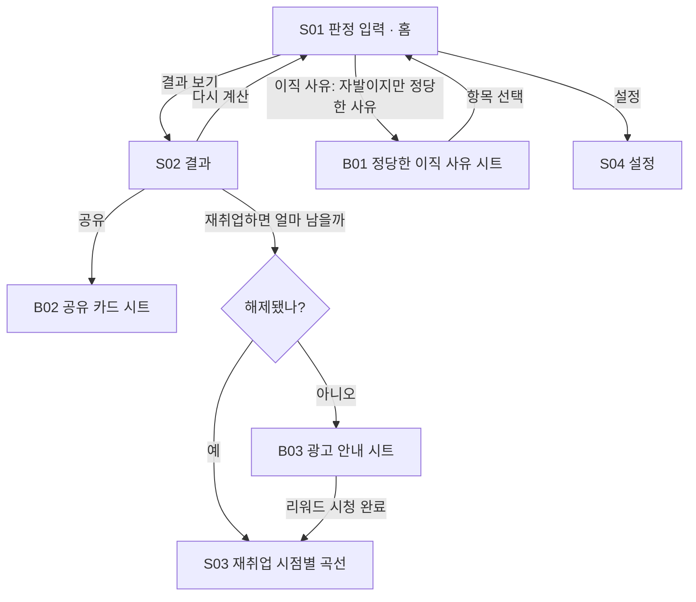

# "실업급여 되나요?" — 화면 흐름

| 항목 | 내용 |
|---|---|
| 문서 버전 | v0.1 (2026-09-11) |
| 선행 문서 | [PRD.md](PRD.md), [FUNCTIONAL_SPEC.md](FUNCTIONAL_SPEC.md) |
| 구조 | net-pay `SCREEN_FLOW.md` 를 따른다 ([PLAYBOOK 2-6](../../docs/PLAYBOOK.md)) |
| 이 문서의 지위 | **5장 카피 일람이 `ko.json` 의 원본이다.** 구현은 여기서 문구를 가져온다 |
| 다음 단계 | 이 문서 승인 → 워크스페이스 → 데이터 → 엔진 → **`/design` 시안 승인** → 화면 구현 |

---

## 1. 네비게이션 맵



### 1-1. 뒤로가기 규칙
| 위치 | 뒤로가기 |
|---|---|
| S01 | **`Screen.close`** — 앱 종료 |
| S02 / S03 / S04 | 직전 화면 |
| B01 / B02 / B03 | 시트만 닫는다 (아래 스와이프·딤 탭도 같음) |

`backEvent` 를 가로채 라우팅한다. 자체 헤더·뒤로가기 버튼은 그리지 않는다 — 토스가 상단 바를 그린다.

## 2. 공통 레이아웃 규칙

### 2-1. 앱인토스 준수
- 상단 바는 토스가 그린다. 하단 탭은 **두지 않는다** — 화면이 4개이고 흐름이 한 방향이다.
- 라이트 모드 고정. 제스처 확대 비활성.
- 세이프 에어리어는 **SDK 값**. CSS `env()` 금지(호스트 값과 이중 적용된다).
- **진입 즉시 시트를 열지 않는다. 예외 없음.** 빈 화면이 다음 할 일을 스스로 가리킨다.
- 입력창 자동 포커스 없음 — 키패드가 결과를 덮는다.
- 배너는 **스크롤 화면의 마지막 요소**로만. 입력 폼 위·시트·로딩에 없다.

### 2-2. 그리드
- 가로 패딩 20px, 카드 사이 12px, 섹션 사이 28px. 하단 고정 버튼 높이 56px + 세이프 에어리어.
- 기준 폭 375px 에서 설계하고 390px 에서 확인한다.

### 2-3. 상태 변주 (모든 화면 공통)
| 상태 | 처리 |
|---|---|
| 입력 미완 | 하단 버튼을 **비활성으로 두지 않는다.** 누르면 첫 빈 칸으로 스크롤 + 그 칸을 강조 |
| 잠김 | **뼈대 막대**로 표시. 실제 수치는 DOM 에 넣지 않는다. 점(`●●●`)은 오류처럼 보여 쓰지 않는다 |
| 광고 실패 | "지금은 광고를 불러올 수 없어요. 잠시 뒤 다시 시도해 주세요." 게이트는 그대로 잠김 |
| 계산 불가 | 판정 `unlikely` 여도 **금액 영역을 비우지 않는다** — 왜 해당하지 않는지 한 줄로 |

## 3. 화면별 와이어프레임

### S01 판정 입력 (홈)
```
┌────────────────────────────────┐
│ 실업급여 되나요?               │  타이틀(--fs-title)
│ 조건을 넣으면 받을 수 있는지,  │  부제(--fs-label, --text-3)
│ 얼마를 며칠 받는지 알려드려요. │
│                                │
│ ┌ 왜 그만두셨어요? ──────────┐ │  카드(가라앉음)
│ │ ○ 회사 사정으로 그만뒀어요 │ │  세그먼트 3개(세로)
│ │ ○ 제가 그만뒀어요          │ │
│ │ ○ 제가 그만뒀지만 사정이   │ │
│ │   있었어요           보기 ›│ │  → B01
│ └────────────────────────────┘ │
│ ┌ 언제부터 언제까지 다녔어요?┐ │
│ │ 입사    [2023-03-01]       │ │  네이티브 date
│ │ 퇴사    [2026-09-30]       │ │
│ │ 3년 6개월 · 고용보험 가입  │ │  파생 표시(--text-3)
│ │ 기간으로 봐요              │ │
│ └────────────────────────────┘ │
│ ┌ 만 나이 ───────────────────┐ │
│ │ [45] 세                    │ │
│ │ □ 장애인이에요             │ │  별표 1 비고
│ └────────────────────────────┘ │
│ ┌ 일주일에 몇 시간 일했어요? ┐ │
│ │ [40] 시간   주휴 [8] 시간  │ │  하한 계산용
│ │ 주휴시간을 모르면 비워도   │ │
│ │ 괜찮아요 (주 40시간 = 8)   │ │
│ └────────────────────────────┘ │
│ ┌ 최근 3개월 월급 ───────────┐ │
│ │ 세전 월급 [3,000,000] 원   │ │  천 단위 콤마
│ │ 3개월 총액으로 계산해요    │ │
│ └────────────────────────────┘ │
│ ─────────────── 배너 ───────── │  스크롤 마지막
│ [        결과 보기        ]    │  하단 고정
└────────────────────────────────┘
```
- 입력 5블록. 이직 사유가 맨 위 — 판정이 이 앱의 훅이다.
- 재직 기간에서 피보험기간 구간과 단위기간을 **파생**한다. 사용자는 180일을 몰라도 된다.
- 주휴시간을 비우면 `주 소정근로시간 ÷ 40 × 8` 로 채운다(안내 문구로 밝힌다).

### S02 결과
```
┌────────────────────────────────┐
│ ┌ 떠 있는 카드 ──────────────┐ │
│ │  요건을 충족하는 것으로    │ │  배지 3상태
│ │  보여요                    │ │
│ │                            │ │
│ │        180 일              │ │  --fs-hero (이 화면의 답)
│ │   하루 66,048원            │ │  --fs-display
│ │   모두 받으면 11,888,640원 │ │  --fs-headline
│ └────────────────────────────┘ │
│ 하루 금액은 원 단위로 내림해   │  일액에 소수가 있을 때만
│ 보여드려요. 총액은 내림하기    │  (--fs-micro, --text-3)
│ 전 금액으로 계산했어요.        │
│ ┌ 왜 이 금액인가요 ──────────┐ │  applied 있을 때만
│ │ 월급이 달라도 금액이 같을  │ │
│ │ 수 있어요. 하루 금액에      │ │
│ │ 법으로 정한 하한이 있어서   │ │
│ │ 그 값이 적용됐어요.         │ │
│ └────────────────────────────┘ │
│ ┌ 계산 내역 ─────────────────┐ │
│ │ 3개월 총액   9,000,000원   │ │
│ │ 평균임금     97,826원/일   │ │
│ │ 1일 소정근로 8시간         │ │
│ │ 하루 하한    66,048원 적용 │ │
│ │ 가입기간     3년 6개월     │ │
│ └────────────────────────────┘ │
│ ┌ 첫 7일은 ──────────────────┐ │
│ │ 신청 후 첫 7일은 지급되지  │ │
│ │ 않아요. 받는 날수는 그대로 │ │
│ │ 180일이에요.               │ │
│ └────────────────────────────┘ │
│ [ 재취업하면 얼마 남을까 🔒 ]  │  게이트 → S03
│ [ 결과 공유하기 ]              │  무료 → B02
│ 고용보험법 [시행 2026.8.20.] · │  기준일
│ 2026년 최저임금 기준           │
│ 실제 수급 자격과 금액은 고용   │  면책
│ 센터 판단에 따라 달라질 수     │
│ 있어요.                        │
│ ─────────────── 배너 ───────── │
└────────────────────────────────┘
```
- **가장 큰 글자는 일수**다. 금액이 대부분 같은 값이라([FUNCTIONAL_SPEC 0-3](FUNCTIONAL_SPEC.md)) 일수가 답이다.
- "왜 이 금액인가요" 카드는 `applied` 에 `minDaily`·`cap`·`minBase` 가 있을 때만 넣는다. 없으면 빈 카드를 두지 않는다.
- 배지 3상태: `likely` 요건을 충족하는 것으로 보여요 / `check` 확인이 필요해요 / `unlikely` 요건에 미치지 않아요.
- **`s02.total.note` 는 일액에 소수가 있을 때만 넣는다.** 관공서와 같이 총액을 내림 전 일액으로 곱하기 때문에 `표시 일액 × 일수 ≠ 총액` 이 된다([FACT_CHECK 3-3](FACT_CHECK.md)). 하한·상한이 걸린 케이스는 소수가 없어 이 줄이 나오지 않는다.

### S03 재취업 시점별 곡선 (게이트)
```
┌────────────────────────────────┐
│ 언제 재취업하면 얼마?          │
│ ┌────────────────────────────┐ │
│ │        ╱▔▔▔╲               │ │  캔버스 곡선
│ │      ╱       ╲__________   │ │  90일에서 계단
│ │    ╱                       │ │
│ │  90일   ← 여기까지 8,916,480│ │
│ └────────────────────────────┘ │
│ 90일째 재취업  8,916,480원     │
│ 91일째 재취업  6,010,368원     │  ← 감소를 나란히
│                                │
│ 남은 날수가 절반(90일) 이상일  │
│ 때 재취업해서 12개월 이상 다니 │
│ 면 남은 날수의 절반을 더 받아요│
│ (조기재취업수당)               │
│ 재취업 후 임금이 높으면 제외될 │  범위 제외 각주
│ 수 있어요.                     │
│ ─────────────── 배너 ───────── │
└────────────────────────────────┘
```
- 이 화면의 전부는 **90일 계단**이다. 곡선만 그리고 설명을 길게 쓰지 않는다.
- 잠김 상태(B03 전)에서는 곡선 자리에 **뼈대 막대**만. 수치는 렌더하지 않는다.

### S04 설정
```
┌────────────────────────────────┐
│ 데이터 출처                    │
│ 고용보험법 [시행 2026.8.20.] › │
│ 별표 1 소정급여일수 (2019.8.27)│
│ 2026년 최저임금 10,320원       │
│                                │
│ 이 앱에 대해                   │
│ 입력한 값은 이 기기 안에서만   │
│ 계산돼요. 외부로 보내지 않아요.│
│ 고용보험·고용노동부가 제공하는 │
│ 서비스가 아니에요. 신청·접수는 │
│ 하지 않아요.                   │
│                                │
│ [ 저장한 계산 전체 삭제 ]      │
│                                │
│ 같은 개발자의 다른 미니앱      │
│ 근무수첩 ›                     │  intoss://work-journal/
│ 세후로 말해줘 ›                │  intoss://net-pay/
│                                │
│ 고객문의 ›                     │
└────────────────────────────────┘
```

### B01 정당한 이직 사유 시트
- 시행규칙 별표 2 **14개 항목을 원문 문구 그대로** 나열한다(요약하면 오인 소지).
- 선택은 하나. 고르면 시트가 닫히고 S01 의 세 번째 세그먼트에 "12. 정년 도래·계약기간 만료" 처럼 표시된다.
- 시트 맨 위: "아래에 해당하면 자발적 퇴사여도 받을 수 있어요. **증빙과 인정 여부는 고용센터가 판단해요.**"

### B02 공유 카드 시트
- 캔버스로 카드 이미지 생성 → 공유. **금액 숨김 토글 기본 켜짐.**
- 숨김일 때 카드에 들어가는 것: 판정 배지 + 일수 + "하루 금액은 숨겼어요". 숨김을 끄면 일액·총액이 들어간다.
- 카드 하단에 딥링크 `intoss://job-benefit/`.

### B03 광고 안내 시트
- "광고를 보면 오늘 하루 곡선을 열어드려요." 보상은 기능 해제뿐 — 포인트·현금성 보상 문구를 쓰지 않는다.
- `onReward` 에서만 해제. `dismissed` 로는 지급하지 않는다.

## 4. 핵심 플로우 시퀀스

### 4-1. 해피 패스
S01 입력 5블록 → [결과 보기] → S02 (배지 `likely`, 180일, 66,048원, 11,888,640원) → [결과 공유하기] → B02 → 공유

### 4-2. 자발 + 정당한 사유
S01 세 번째 세그먼트 탭 → **사용자가 [보기] 를 눌러야** B01 이 열린다 → 항목 12 선택 → S01 복귀 → [결과 보기] → S02 배지 **`check`** ("확인이 필요해요") + 금액은 그대로 보여 준다

### 4-3. 게이트 → 광고 → 곡선
S02 [재취업하면 얼마 남을까 🔒] → B03 → 리워드 시청 → `onReward` → `unlockedUntil` = 기기 로컬 자정 → S03. 자정 이후 재진입 시 다시 잠김.

### 4-4. 추정 단위기간이 경계
입사 2026-04-01 / 퇴사 2026-09-30 → 추정 183일 → 180 근처 → 배지 **`check`** + "무급휴직·결근이 있으면 실제 가입 일수가 180일에 못 미칠 수 있어요"

## 5. 카피 일람 (`ko.json` 원본, 린트 대상)

| 키 | 문구 |
|---|---|
| `app.title` | 실업급여 되나요? |
| `app.subtitle` | 조건을 넣으면 받을 수 있는지, 얼마를 며칠 받는지 알려드려요. |
| `s01.reason.label` | 왜 그만두셨어요? |
| `s01.reason.involuntary` | 회사 사정으로 그만뒀어요 |
| `s01.reason.voluntary` | 제가 그만뒀어요 |
| `s01.reason.justified` | 제가 그만뒀지만 사정이 있었어요 |
| `s01.reason.justified.link` | 어떤 사정인지 보기 |
| `s01.period.label` | 언제부터 언제까지 다녔어요? |
| `s01.period.hired` | 입사 |
| `s01.period.quit` | 퇴사 |
| `s01.period.derived` | {years}년 {months}개월 · 고용보험 가입 기간으로 봐요 |
| `s01.age.label` | 만 나이 |
| `s01.age.disabled` | 장애인이에요 |
| `s01.hours.label` | 일주일에 몇 시간 일했어요? |
| `s01.hours.week` | 주 소정근로 |
| `s01.hours.holiday` | 주휴 |
| `s01.hours.hint` | 주휴시간을 모르면 비워도 괜찮아요. 주 40시간이면 8시간으로 봐요. |
| `s01.wage.label` | 최근 3개월 월급 |
| `s01.wage.hint` | 세전 월급이에요. 3개월 총액으로 계산해요. |
| `s01.submit` | 결과 보기 |
| `s01.submit.empty` | 아직 안 채운 칸이 있어요 |
| `s02.verdict.likely` | 요건을 충족하는 것으로 보여요 |
| `s02.verdict.check` | 확인이 필요해요 |
| `s02.verdict.unlikely` | 요건에 미치지 않아요 |
| `s02.days` | {days}일 |
| `s02.daily` | 하루 {amount}원 |
| `s02.total` | 모두 받으면 {amount}원 |
| `s02.total.note` | 하루 금액은 원 단위로 내림해 보여드려요. 총액은 내림하기 전 금액으로 계산했어요. |
| `s02.why.title` | 왜 이 금액인가요 |
| `s02.why.minDaily` | 월급이 달라도 금액이 같을 수 있어요. 하루 금액에 법으로 정한 하한이 있어서 그 값이 적용됐어요. |
| `s02.why.cap` | 하루 금액에 법으로 정한 상한이 있어서 그 값이 적용됐어요. |
| `s02.why.minBase` | 일주일에 일한 시간이 짧아 하한이 그만큼 낮게 계산됐어요. |
| `s02.detail.title` | 계산 내역 |
| `s02.waiting.title` | 첫 7일은 |
| `s02.waiting.body` | 신청 후 첫 7일은 지급되지 않아요. 받는 날수는 그대로 {days}일이에요. |
| `s02.reason.insuredShort` | 고용보험 가입 기간이 짧아 요건에 미치지 않는 것으로 보여요. |
| `s02.reason.insuredNear` | 무급휴직이나 결근이 있으면 실제 가입 일수가 180일에 못 미칠 수 있어요. |
| `s02.reason.voluntaryNotJustified` | 스스로 그만둔 경우에는 원칙적으로 받을 수 없어요. |
| `s02.reason.justifiedNeedsProof` | 증빙과 인정 여부는 고용센터가 판단해요. |
| `s02.cta.curve` | 재취업하면 얼마 남을까 |
| `s02.cta.share` | 결과 공유하기 |
| `s02.basis` | 고용보험법 [시행 2026. 8. 20.] · 2026년 최저임금 기준 |
| `s02.disclaimer` | 실제 수급 자격과 금액은 고용센터 판단에 따라 달라질 수 있어요. |
| `s03.title` | 언제 재취업하면 얼마? |
| `s03.point` | {day}일째 재취업 |
| `s03.body` | 남은 날수가 절반({half}일) 이상일 때 재취업해서 12개월 이상 다니면 남은 날수의 절반을 더 받아요. |
| `s03.note.highWage` | 재취업 후 임금이 높으면 제외될 수 있어요. |
| `s04.source.title` | 데이터 출처 |
| `s04.about.privacy` | 입력한 값은 이 기기 안에서만 계산돼요. 외부로 보내지 않아요. |
| `s04.about.notOfficial` | 고용보험·고용노동부가 제공하는 서비스가 아니에요. 신청·접수는 하지 않아요. |
| `s04.clear` | 저장한 계산 전체 삭제 |
| `s04.others.title` | 같은 개발자의 다른 미니앱 |
| `b01.title` | 스스로 그만뒀어도 받을 수 있는 사정 |
| `b01.lead` | 아래에 해당하면 자발적 퇴사여도 받을 수 있어요. 증빙과 인정 여부는 고용센터가 판단해요. |
| `b02.title` | 결과 공유하기 |
| `b02.hideAmount` | 금액 숨기기 |
| `b02.hidden` | 하루 금액은 숨겼어요 |
| `b03.title` | 오늘 하루 열기 |
| `b03.body` | 광고를 보면 오늘 하루 곡선을 열어드려요. |
| `b03.cta` | 광고 보고 열기 |
| `ad.failed` | 지금은 광고를 불러올 수 없어요. 잠시 뒤 다시 시도해 주세요. |

**자리표시자는 `{name}` 단일 중괄호다** — `@ait/kit` 의 `createT` 규약이다.

**린트 금지어 확인** — 위 문구에 상품(대출·보험·카드·투자)·권고(그만두세요·이득·유리해요·추천)·오인(공식·제공·인증·신청 대행) 표현이 없다. `s04.about.notOfficial` 의 "제공"·"신청"은 **부정문**이므로 화이트리스트에 넣는다. "고용보험법"·"고용보험 가입 기간"도 법령·제도 명칭이라 화이트리스트.

## 6. 디자인 토큰

**net-pay `SCREEN_FLOW.md` 6장을 그대로 공유한다.** 값을 다시 적지 않는다 — `net-pay/src/styles.css` 를 복사해 시작하고 아래만 추가한다.

| 추가 토큰 | 값 | 용도 |
|---|---|---|
| `--verdict-likely` / `-weak` | `--primary` / `--primary-weak` | 배지 `likely` |
| `--verdict-check` / `-weak` | `--warn` / `--warn-weak` | 배지 `check` |
| `--verdict-unlikely` / `-weak` | `--gray-700` / `--gray-100` | 배지 `unlikely`. **`--danger` 를 쓰지 않는다** — 요건 미달은 오류가 아니다 |

지켜야 할 규칙(net-pay 6-3에서 가져옴): `word-break: keep-all`, `font` 단축 문법에 `inherit` 금지, 입력 필드 16px 이상, 모든 버튼에 `:active`, 아이콘은 인라인 SVG만, **잠긴 값은 뼈대 막대**, 층은 셋(배경·떠 있는 카드·가라앉은 블록), 화면에서 가장 큰 글자는 그 화면의 답.

## 7. 컴포넌트 인벤토리 (재사용 출처)

| 컴포넌트 | 출처 | 비고 |
|---|---|---|
| 시트(드래그 닫기) | work-journal | 손잡이·제목 줄에서만 드래그. `touch-action` 분리 |
| 결과 카드 · 판정 배지 | rent-calc | 3상태로 확장 |
| 캔버스 차트 | fx-replay → rent-calc | 곡선 + 계단 강조로 변형 |
| 공유 카드 생성 | net-pay 협상 카드 | 금액 숨김 토글 포함 |
| 숫자 입력·콤마 | net-pay | 16px 이상 |
| 뼈대 막대 | net-pay | 잠금 표시 |
| 광고·저장·네비·백스택·공유·환경·i18n | `@ait/kit` | 앱 안에 다시 만들지 않는다 |
| 스크린샷 촬영 | rent-calc `scripts/shoot.mjs` | 출시 준비 단계 |

## 8. 오픈 이슈
- **F-1. 추정 단위기간의 `check` 폭** — 150~210일을 `check` 로 두었다(3-6 AC-2). 임의값이다. 시안 검토에서 조정한다.
- **F-2. 주휴시간 기본값** — 비우면 `주 시간 ÷ 40 × 8` 로 채운다. 주 15시간 미만은 주휴가 없어 0 이 맞다 → 엔진에서 분기할지 입력에서 막을지 구현 시 확정.
- **F-3. S03 곡선의 x축 해상도** — 271점을 그대로 그릴지, 1/2 경계 앞뒤만 촘촘히 그릴지 시안에서 결정.
