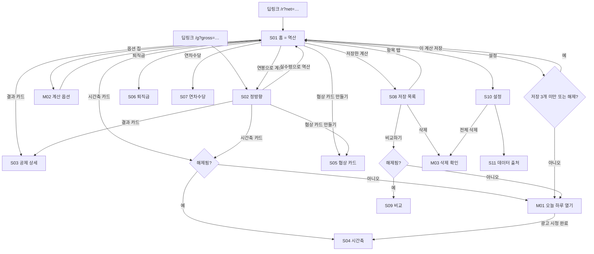

# 화면 흐름·와이어프레임 — net-pay ("세후로 말해줘")

| 항목 | 내용 |
|---|---|
| 문서 버전 | v0.3 (2026-09-08) |
| 상위 문서 | [FUNCTIONAL_SPEC.md](FUNCTIONAL_SPEC.md) v0.1 (화면 ID·동작 규칙), [PRD.md](PRD.md) v0.3 (원칙 A·B·C·D) |
| 범위 | v1.0 전 화면. 와이어프레임은 저해상도(구조·우선순위·카피)만 정의. 색·타이포는 6장 최소 토큰 |
| 기준 뷰포트 | 360×780 (안드로이드 중급기), 상단은 앱인토스 네비게이션 바가 차지 |

---

## 1. 네비게이션 맵



뒤로가기 규칙: S01에서 뒤로가기(네비게이션 바·안드로이드 백버튼) = 미니앱 종료. S02는 S01의 형제 화면이지만 뒤로가기 = S01. 나머지 화면은 직전 화면. 바텀시트·다이얼로그에서 백버튼 = 닫기. 광고 표시 중 백버튼은 SDK가 처리한다.

---

## 2. 공통 레이아웃 규칙

### 2-1. 앱인토스 네비게이션 바 (체크리스트 준수)
- 토스가 그리는 네비게이션 바 사용(`withBackButton, withHomeButton, withTitle`, 라이트). 미니앱 자체 헤더·뒤로가기 버튼 없음.
- 타이틀: S01·S02 "세후로 말해줘", 그 외 화면 이름("공제 상세", "퇴직금" 등).

### 2-2. 세이프 에어리어·그리드

**CSS `env(safe-area-inset-*)` 를 쓰지 않는다.** 앱인토스는 SDK `SafeArea` 를 쓰라고 하고,
env() 를 함께 쓰면 호스트 처리와 겹쳐 이중 적용된다(fx-replay 실기기 확인).
`@ait/kit` 의 `useSafeArea()` 가 `--safe-top` / `--safe-bottom` CSS 변수로 내보내고 앱은 그것만 쓴다.

`--safe-bottom` 을 더하는 곳
- `.screen`, `.settings-link` — 안드로이드 뷰포트가 시스템 내비 바 아래까지 이어져 마지막 요소가 잘린다
- `.sheet`, `.dialog` — 홈 인디케이터를 비켜야 한다
- `.toast` — 같은 이유

- 좌우 여백 20, 카드 간격 12, 카드 내부 여백 16. 세로 스크롤 컨테이너 하나. 가로 스크롤 없음.
- 숫자 입력 화면(S01·S02·S06·S07)은 키패드가 올라올 때 결과 카드가 가려지지 않도록 입력을 상단에 고정하고 결과는 입력 바로 아래에 둔다.
- 배너는 항상 스크롤 콘텐츠의 마지막 요소. 키패드 위·고정 하단 금지.

### 2-3. 상태 변주(모든 화면 공통)
| 상태 | 표현 |
|---|---|
| 입력 없음 | 결과 카드 대신 예시 한 줄: "예) 300만 원을 입력하면 필요한 연봉을 계산해요" |
| 로딩 | 없음(계산은 동기, 데이터는 번들). 광고 로딩만 버튼 내 스피너 |
| 빈 상태 | 한 문장 + CTA 1개. 예) "저장한 계산이 없어요" / [홈으로] |
| 오류 | 토스트(3초). 화면 전체 오류는 데이터 파일 로드 실패 때만: "데이터를 불러오지 못했어요. 앱을 다시 열어 주세요" |
| 오프라인 | 광고 버튼에만 "인터넷 연결이 필요해요". 나머지 정상 |
| 잠금(게이트) | 카드 헤드라인은 보이고 수치 영역만 블러 + 🔒 "광고 보고 오늘 하루 열기" |
| 데이터 구버전 | S01 상단 얇은 띠: "{Y}년 요율은 아직 반영 전이에요. {Y−1}년 기준으로 계산합니다" |

---

## 3. 화면별 와이어프레임

### S01 홈 = 역산

```
┌──────────────────────────────────┐
│ ‹  세후로 말해줘              ⋯   │  ← 앱인토스 네비게이션 바
├──────────────────────────────────┤
│ {Y}년 요율 반영 전 안내 (있을 때만) │  얇은 띠
│                                  │
│ 세후로 월                         │  H1 라벨
│ ┌──────────────────────┐ 만 원    │  큰 숫자 입력(숫자 키패드)
│ │ 300                  │ 받고     │
│ └──────────────────────┘ 싶어요   │
│ [가족 1명] [자녀 0] [식대 포함] ⚙  │  옵션 칩 → M02
│                                  │
│ ┌ 결과 ────────────────────────┐ │
│ │ 연봉 약 4,470만 원이 필요해요   │ │  H2, 만 원 단위
│ │ 이 연봉의 월 실수령 3,001,240원 │ │  보조
│ │ 월 공제 합계 724,760원      › │ │  탭 → S03
│ │ 국민연금 · 건강 · 장기요양 ·   │ │  1줄 요약
│ │ 고용 · 소득세 · 지방소득세      │ │
│ └──────────────────────────────┘ │
│ 지금 연봉이 있다면 → 연봉으로 계산 │  텍스트 링크 → S02
│                                  │
│ ┌ 이 연봉, 5년 전이었다면 ─────┐ │  시간축 카드(게이트)
│ │ ▓▓▓▓ 2021  ▓▓▓▓▓ 2026 (블러)  │ │  잠금: 수치 블러 + 🔒
│ │ 🔒 광고 보고 오늘 하루 열기     │ │  해제: 미니 막대 4개 + "자세히 ›"
│ └──────────────────────────────┘ │
│ [협상 카드 만들기]  [이 계산 저장] │  보조 버튼 2개(무료)
│                                  │
│ 다른 계산                        │
│ ┌ 퇴직금 ›     ┐┌ 연차수당 ›    ┐ │
│ └──────────────┘└──────────────┘ │
│ 저장한 계산 (2) ›                 │
│                                  │
│ 입력한 금액은 이 기기 안에서만     │  원칙 C4, 작은 글씨
│ 계산돼요.                         │
│ 기준: 간이세액표 2026-03-01 시행 · │  원칙 B2
│ 2026년 4대보험 요율 · 참고용       │
│ ▤ 배너 광고 (스크롤 끝)           │
└──────────────────────────────────┘
```
- 첫 진입에 시트·팝업 없음. 입력창에 자동 포커스하지 않는다(키패드가 첫 화면을 덮으면 결과 카드·차별점이 안 보인다). 사용자가 입력창을 탭했을 때만 키패드.
- 마지막 입력값이 있으면 채워진 상태로 열리고 결과 카드까지 바로 보인다.
- 딥링크 진입 시 파라미터 값으로 채우고 결과 카드까지 렌더.

### M02 계산 옵션 (바텀시트)

```
┌──────────────────────────────────┐
│ 계산 옵션                      ✕ │
│ 공제대상 가족 수 (본인 포함)       │
│   [−]  1명  [+]                  │  1~11
│ 8세 이상 20세 이하 자녀           │
│   [−]  0명  [+]                  │  0~10, 가족 수 자동 보정 안내
│ 비과세 식대 월 20만 원 포함  [●]  │  토글
│ 기준일  2026-09-07 ▾             │  기본 오늘. 시간축 외에는 변경 드묾 → 접힘
│ ─────────────────────────────── │
│ 자녀도 공제대상 가족에 포함돼요.   │  보정 발생 시만
│ 가족 수를 2명으로 맞췄어요.        │
│ [적용]                           │
└──────────────────────────────────┘
```
- 값 변경은 즉시 뒤 화면 결과에 반영(적용 버튼은 닫기 역할).

### S02 정방향

S01과 동일한 골격. 차이만 기술.
- 입력 라벨 "연봉" + 큰 숫자 입력 + "만 원". 결과 카드 헤드라인 "월 실수령 3,001,240원", 보조 "연 36,014,880원 · 월 공제 724,760원 ›".
- 텍스트 링크 "받고 싶은 실수령이 있다면 → 실수령으로 역산" → S01.
- 시간축·협상 카드·저장·다른 계산·안내·배너 동일.

### S03 공제 상세

```
┌──────────────────────────────────┐
│ ‹  공제 상세                       │
├──────────────────────────────────┤
│ 연봉 44,700,000원 · 가족 1 · 자녀 0 │  입력 요약
│ ┌──────────────────────────────┐ │
│ │ 항목        월        연간    │ │  표. 숫자 고정폭, 우측 정렬
│ │ 세전 월급   3,725,000  44,700,000│
│ │ 비과세 식대  −200,000  −2,400,000│
│ │ 과세 월급   3,525,000  42,300,000│
│ │ ─────────────────────────────│ │
│ │ 국민연금     167,430   2,009,160│  4.75% · 상한 적용 시 [상한] 배지
│ │ 건강보험     126,720   1,520,640│  3.595%
│ │ 장기요양      16,650     199,800│  건보료의 13.14%
│ │ 고용보험      31,720     380,640│  0.9%
│ │ 소득세       ○○○,○○○  ○,○○○,○○○│  간이세액표 2026-03-01 · 가족 1 · 자녀 0
│ │ 지방소득세    ○○,○○○    ○○○,○○○│  소득세의 10%
│ │ ─────────────────────────────│ │
│ │ 공제 합계    724,760   8,697,120│  강조
│ │ 월 실수령   3,001,240  36,014,880│  H2
│ └──────────────────────────────┘ │
│ 역산 결과일 때만:                  │
│ "실수령이 목표 3,000,000원 이상이   │
│  되는 가장 낮은 연봉이에요."        │
│                                  │
│ 간이세액표·공단 요율 기준 참고용    │  원칙 B1
│ 계산입니다. 실제 공제액은 회사·    │
│ 개인 상황에 따라 다를 수 있어요.   │
│ 연말정산 결과는 반영되지 않습니다. │  원칙 B4
│ 기준: 간이세액표 2026-03-01 시행 · │  원칙 B2
│ 2026년 4대보험 요율               │
│ ▤ 배너 광고                        │
└──────────────────────────────────┘
```
- 위 표의 예시 수치는 레이아웃용이며 골든 테스트 확정 후 문서에서 삭제한다(오해 방지).
- 각 행 탭 → 산식 한 줄 토글("3,525,000 × 4.75% = 167,437 → 원 미만 절사").

### M01 오늘 하루 열기 (바텀시트)

```
┌──────────────────────────────────┐
│ 오늘 하루 열기                  ✕ │
│ 광고를 보면 오늘 자정까지          │
│ · 이 연봉, 5년 전이었다면          │
│ · 저장한 계산 2개 비교             │
│ · 저장 20개                        │
│ 를 쓸 수 있어요.                   │
│ [광고 보고 열기]                   │  loaded 상태만 활성. 로딩 중이면 스피너
│ (다음에)                           │
└──────────────────────────────────┘
```
- 진입 트리거는 사용자 탭만(시간축 카드·비교하기·4번째 저장). 자동 오픈 없음.
- 광고 완료 → 시트 닫힘 → 원래 목적지(S04/S09/저장 완료)로 이동 + 토스트 "오늘 자정까지 열렸어요".
- 광고 실패 → 시트 유지 + 토스트 "지금은 광고를 불러올 수 없어요. 잠시 후 다시 시도해 주세요".

### S04 시간축

```
┌──────────────────────────────────┐
│ ‹  이 연봉, 5년 전이었다면          │
├──────────────────────────────────┤
│ 연봉 44,700,000원 기준             │
│ 같은 연봉이라면 2021년보다 매달     │  H2 서술형(평가 없음)
│ 28,140원을 더 내게 됐어요.          │
│ ┌──────────────────────────────┐ │
│ │ 월 실수령                      │ │  막대 6개, 값 라벨 위
│ │ ▇3,029  ▇3,024  ▇3,018 ▇3,015│ │  (천 원 단위 라벨)
│ │ ▇3,012  ▇3,001                │ │
│ │ 2021  2022  2023  2024  2025 2026│
│ └──────────────────────────────┘ │
│ ┌ 연도별 요율 ─────────────────┐ │
│ │ 연도  국민연금  건강보험  장기요양│ │  총요율(근로자+사업주)
│ │ 2021  9.0%    6.86%    11.52% │ │
│ │ …                             │ │
│ │ 2026  9.5%    7.19%    13.14% │ │
│ └──────────────────────────────┘ │
│ 각 연도 하반기 시행 요율 기준.      │
│ 소득세는 현행 세액표 기준으로       │  fallback 연도 있을 때만
│ 계산했어요.                        │
│ [이 카드 공유하기]                 │  → S05(시간축 변형 카드)
│ 참고용 계산 · 기준 문구            │
└──────────────────────────────────┘
```
- 배너 없음(집중 화면). 막대 색은 단일색, 증감에 색 의미 부여 안 함.
- 요율 표의 과거 값은 오픈 이슈 O-4 확정 후 데이터에서 채운다(위 표는 예시).

### S05 협상 카드

```
┌──────────────────────────────────┐
│ ‹  협상 카드                       │
├──────────────────────────────────┤
│ ┌──────────────────────────────┐ │  4:5 미리보기(캔버스 렌더)
│ │  세후 월 300만 원              │ │
│ │  = 연봉 약 4,470만 원          │ │  숨김 on이면 이 줄·다음 줄 제거
│ │  2026년 기준 · 월 공제 약 72만 원│ │
│ │                               │ │
│ │  참고용 계산 · 간이세액표 기준   │ │  면책 한 줄
│ │  세후로 말해줘 · 토스에서 열기   │ │  앱 이름 + 딥링크 텍스트
│ └──────────────────────────────┘ │
│ 연봉 숨기기                  [○]  │  토글, 기억됨
│ [이미지 저장]     [링크 공유]      │  저장 미지원 기기는 버튼 숨김
│ 카드를 저장·공유해도 이 앱은       │
│ 입력값을 서버로 보내지 않아요.     │
└──────────────────────────────────┘
```
- S04에서 진입한 경우 카드 변형: "같은 연봉이라면 2021년보다 매달 28,140원을 더 내게 됐어요" + 막대 6개.
- 배너 없음.

### S06 퇴직금

```
┌──────────────────────────────────┐
│ ‹  퇴직금                          │
├──────────────────────────────────┤
│ 입사일        [2021-03-02 ▾]      │  date input
│ 마지막 근무일  [2026-08-31 ▾]      │
│ 퇴직 전 3개월 임금 총액            │
│ [11,175,000] 원  (세전 월급×3 채움) │  수정 가능
│ 연간 상여 (선택)   [_______] 원    │
│ 연차수당 (선택)    [_______] 원    │
│ 1일 통상임금 (선택) [______] 원    │  평균임금보다 크면 적용 안내
│ ┌ 결과 ────────────────────────┐ │
│ │ 예상 퇴직금(세전)              │ │
│ │ 20,3○○,○○○원                  │ │  H2
│ │ 재직 5년 5개월 30일 · 1,979일   │ │
│ │ 1일 평균임금 12○,○○○원          │ │
│ │ 산식 보기 ›                    │ │  토글: (임금총액+상여×3/12+연차×3/12)÷92일 ×30×1,979/365
│ └──────────────────────────────┘ │
│ 1년 미만: "퇴직금 지급 대상이 아닐  │  조건부
│ 수 있어요"                         │
│ 퇴직소득세는 별도로 계산돼요.       │  v1.0 안내
│ 참고용 계산 · 기준 문구            │
└──────────────────────────────────┘
```
- 배너 없음(입력 화면). 결과는 입력 바로 아래 갱신.

### S07 연차수당

```
┌──────────────────────────────────┐
│ ‹  연차수당                        │
├──────────────────────────────────┤
│ 월 통상임금  [3,000,000] 원        │  세전 월급으로 채움
│ 월 소정근로시간 [209] 시간          │  기본 209
│ 미사용 연차   [5] 일               │  0.5 단위
│ ┌ 결과 ────────────────────────┐ │
│ │ 예상 연차수당(세전) 574,160원    │ │  H2
│ │ 시급 14,354원 · 일급 114,832원  │ │
│ │ 산식 보기 ›                    │ │
│ └──────────────────────────────┘ │
│ 통상임금에 포함되는 수당은 회사     │
│ 규정에 따라 달라요.                │
│ 참고용 계산 · 기준 문구            │
└──────────────────────────────────┘
```

### S08 저장 목록

```
┌──────────────────────────────────┐
│ ‹  저장한 계산                     │
├──────────────────────────────────┤
│ 무료 3개 · 오늘 하루 열기로 20개    │  상태 줄(해제 시 "오늘 자정까지 20개")
│ ┌──────────────────────────────┐ │
│ │ ☐ 계산 1 · 역산               │ │  체크박스(비교 선택)
│ │   세후 300만 → 연봉 약 4,470만  │ │
│ │   2026-09-07                   │ │
│ ├──────────────────────────────┤ │
│ │ ☐ 계산 2 · 연봉               │ │
│ │   연봉 5,000만 → 실수령 3,5○○,○○○│ │
│ └──────────────────────────────┘ │
│ [비교하기 (2개 선택 시 활성)]      │  게이트
│ 길게 눌러 삭제                     │
│ ▤ 배너 광고                        │
└──────────────────────────────────┘
```
- 항목 탭 → 해당 모드 화면(S01/S02)에 입력 복원.

### S09 비교

```
┌──────────────────────────────────┐
│ ‹  비교                            │
├──────────────────────────────────┤
│ ┌──────────────────────────────┐ │
│ │            계산 1    계산 2  차이│ │
│ │ 연봉      44,700,000 50,000,000 +5,300,000│
│ │ 세전 월급  3,725,000  4,166,666 +441,666 │
│ │ 국민연금 …                     │ │
│ │ 공제 합계 …                    │ │
│ │ 월 실수령  3,001,240  3,3○○,○○○ +3○○,○○○│
│ └──────────────────────────────┘ │
│ 차이는 부호만 표시(색 강조 없음).   │
│ 참고용 계산 · 기준 문구            │
└──────────────────────────────────┘
```
- 평가 문구·"유리/불리" 없음(원칙 B3). 배너 없음.

### M03 삭제 확인 (다이얼로그)
- 단일: "'계산 1'을 삭제할까요?" [삭제] [취소].
- 전체(S10): 1단계 "저장한 계산과 설정을 모두 삭제할까요?" → 2단계 "되돌릴 수 없어요. 정말 삭제할까요?" [모두 삭제].

### S10 설정

```
┌──────────────────────────────────┐
│ ‹  설정                            │
├──────────────────────────────────┤
│ 데이터 기준                        │
│  간이세액표   2026-03-01 시행       │
│  4대보험 요율 2026년 (7월 개정 반영) │
│  다음 갱신 예정 매년 1월·3월·7월     │
│  데이터 출처 보기 ›                 │  → S11
│ 데이터                             │
│  저장한 계산·설정 모두 삭제 ›       │  → M03 2단계
│ 지원                               │
│  고객문의 (이메일) ›                │
│ 같은 개발자의 다른 미니앱           │
│  그때 환전했다면 ›                  │  intoss:// 스킴
│ 버전 1.0.0                         │
└──────────────────────────────────┘
```

### S11 데이터 출처

| 항목 | 표기 |
|---|---|
| 간이세액표 | 국세청 근로소득 간이세액표(소득세법 시행령 별표 2), 2026-03-01 시행, 공공데이터포털 이용허락범위 제한 없음, 확인일, URL |
| 국민연금 | 국민연금공단 2026년도 기준소득월액 상·하한액 조정 안내, 확인일, URL |
| 건강보험·장기요양 | 보건복지부 고시 월별 건강보험료액의 상한과 하한에 관한 고시, 확인일, URL |
| 고용보험 | 고용노동부 고시 요율, 확인일 |
| 퇴직금·연차수당 | 근로기준법, 근로자퇴직급여보장법 산식 |
| 고지 | "국세청·공단이 제공·인증한 서비스가 아닙니다." |

---

## 4. 핵심 플로우 시퀀스

### 4-1. 역산 → 상세 (해피 패스)
1. S01 진입(마지막 입력 복원) → 입력창 탭 → "300" → 300ms 후 결과 카드.
2. 옵션 칩 "가족 1명" 탭 → M02 → 자녀 1 → 가족 자동 2 → [적용] → 결과 갱신.
3. 결과 카드 탭 → S03 → 항목 탭으로 산식 확인 → 뒤로가기 → S01.

### 4-2. 시간축 게이트 → 광고 → S04 → 카드 공유
1. S01 시간축 카드(잠금) 탭 → M01.
2. [광고 보고 열기] → 리워드 광고 → `userEarnedReward` → `unlock.until` 저장 → 시트 닫힘 → S04 + 토스트.
3. S04 [이 카드 공유하기] → S05(시간축 변형) → [링크 공유] → 네이티브 공유 시트.
4. 수신자가 링크 탭 → 토스 → 미니앱 `/r?net=…` → S01에 값 채워진 채 열림.

### 4-3. 저장 4개째
1. S01 [이 계산 저장] → 저장 3개 존재·잠금 → M01. [다음에] → 저장 안 됨, 토스트 없음.
2. 해제 상태 → 저장 완료 토스트 "저장했어요 (4/20)".

### 4-4. 딥링크 진입 (정방향)
`intoss://net-pay/g?gross=50000000&dep=2&kids=1` → S02에 연봉 5,000만·가족 2·자녀 1 채움 → 결과 카드 렌더. 잘못된 `kids=abc`는 무시(0).

---

## 5. 카피 일람 (린트 대상, 확정 문구)

| 키 | 문구 | 비고 |
|---|---|---|
| app.title | 세후로 말해줘 | |
| home.input.prefix / .suffix | 세후로 월 / 만 원 받고 싶어요 | |
| home.input.placeholder | 300 | |
| home.result.headline | 연봉 약 {gross}만 원이 필요해요 | "약" 고정 |
| home.result.sub | 이 연봉의 월 실수령 {net}원 | |
| home.result.deductions | 월 공제 합계 {ded}원 | |
| home.switch.toForward | 지금 연봉이 있다면 → 연봉으로 계산 | 린트 화이트리스트("지금") |
| gross.input.prefix / .suffix | 연봉 / 만 원 | |
| gross.result.headline | 월 실수령 {net}원 | |
| gross.result.sub | 연 {netAnnual}원 · 월 공제 {ded}원 | |
| gross.switch.toReverse | 받고 싶은 실수령이 있다면 → 실수령으로 역산 | |
| timeline.card.title | 이 연봉, 5년 전이었다면 | |
| timeline.headline.more | 같은 연봉이라면 {y0}년보다 매달 {delta}원을 더 내게 됐어요 | 서술형 |
| timeline.headline.less | 같은 연봉이라면 {y0}년보다 매달 {delta}원을 덜 내게 됐어요 | |
| timeline.footnote.rates | 각 연도 하반기 시행 요율 기준. | |
| timeline.footnote.fallback | 소득세는 현행 세액표 기준으로 계산했어요. | fallback 시만 |
| gate.title | 오늘 하루 열기 | |
| gate.body | 광고를 보면 오늘 자정까지 시간축 비교·저장한 계산 비교·저장 20개를 쓸 수 있어요. | |
| gate.cta / gate.later | 광고 보고 열기 / 다음에 | |
| gate.unlocked.toast | 오늘 자정까지 열렸어요 | |
| ad.unavailable | 지금은 광고를 불러올 수 없어요. 잠시 후 다시 시도해 주세요 | 화이트리스트("지금") |
| card.headline | 세후 월 {net}만 원 | |
| card.line.gross | = 연봉 약 {gross}만 원 | 숨김 시 제거 |
| card.line.meta | {year}년 기준 · 월 공제 약 {ded}만 원 | 숨김 시 제거 |
| card.disclaimer | 참고용 계산 · 간이세액표 기준 | |
| card.footer | 세후로 말해줘 · 토스에서 열기 | |
| card.hideGross | 연봉 숨기기 | |
| card.share.text | 세후 월 {net}만 원 = 연봉 약 {gross}만 원 (참고용 계산) | 숨김 시 "= 연봉…" 제거 |
| save.cta | 이 계산 저장 | |
| save.done | 저장했어요 ({n}/{cap}) | |
| save.capReached | 최대 20개까지 저장할 수 있어요 | |
| severance.underOneYear | 1년 미만 근무는 퇴직금 지급 대상이 아닐 수 있어요 | |
| severance.taxNote | 퇴직소득세는 별도로 계산돼요. | |
| leave.note | 통상임금에 포함되는 수당은 회사 규정에 따라 달라요. | |
| privacy.line | 입력한 금액은 이 기기 안에서만 계산돼요. | 원칙 C4 |
| basis.line | 기준: 간이세액표 {effectiveFrom} 시행 · {year}년 4대보험 요율 | 원칙 B2 |
| disclaimer.full | 간이세액표·공단 요율 기준 참고용 계산입니다. 실제 공제액은 회사·개인 상황에 따라 다를 수 있어요. | 원칙 B1 |
| disclaimer.yearEnd | 연말정산 결과는 반영되지 않습니다. | 원칙 B4 |
| data.stale | {y}년 요율은 아직 반영 전이에요. {y0}년 기준으로 계산합니다 | |
| sources.notAffiliated | 국세청·공단이 제공·인증한 서비스가 아닙니다. | |

---

## 6. 최소 디자인 토큰

| 토큰 | 값 | 용도 |
|---|---|---|
| `color.bg` | #FFFFFF | 배경(라이트 고정) |
| `color.surface` | #F7F8FA | 카드 |
| `color.text` / `.sub` | #191F28 / #6B7684 | 본문 / 보조 |
| `color.primary` | #3182F6 | CTA, 시간축 막대(단일색) |
| `color.lock` | #8B95A1 | 잠금 상태 아이콘·블러 위 텍스트 |
| `color.diff` | text 색 + 부호만 | 비교·시간축 차이. 증감에 색 의미 없음 |
| `radius.card` | 16 | |
| `type.h1` / `.h2` / `.body` / `.num` | 22/700 · 20/700 · 15/400 · 20/600 tabular | 금액은 고정폭 |
| `type.input` | 32/700 tabular | S01·S02 큰 숫자 입력 |

- fx-replay와 토큰을 공유한다. TDS(토스 디자인 시스템) WebView 패키지 사용이 가능하면 버튼·바텀시트·토스트는 TDS로 대체(오픈 이슈 O-3).

---

## 7. 컴포넌트 인벤토리

| 컴포넌트 | 사용 화면 | 상태 | 출처 |
|---|---|---|---|
| `MoneyInput` (만 원/원 단위, 콤마, 숫자 키패드) | S01 S02 S06 S07 | empty / filled / invalid | 신규 |
| `OptionChips` + `OptionsSheet`(M02) | S01 S02 | — | 신규 |
| `ResultCard` (역산/정방향 변형) | S01 S02 | empty / result | 신규 |
| `DeductionTable` (행 탭 산식 토글, 상한 배지) | S03 S09 | — | 신규 |
| `LockedCard` (블러 + 🔒) | S01 S02 S08 | locked / unlocked | 신규 |
| `BarChart` (막대 6개, 값 라벨) | S04 S05 | — | fx-replay `CandleChart` 캔버스 유틸 확장 |
| `NegotiationCard` (캔버스 1080×1350) | S05 | default / hideGross / timeline | fx-replay `shareCard.ts` 구조 재사용 |
| `GateSheet`(M01) | 전역 | idle / loading / loaded / failed | 신규, kit `useRewardedAd` |
| `BannerAd` | S01 S02 S03 S08 | — | fx-replay `BannerAd.tsx` → kit 이동 후보 |
| `ConfirmDialog`(M03) | S08 S10 | 1단계 / 2단계 | 신규 |
| `BasisFooter` (기준·면책·개인정보 한 줄) | S01 S02 S03 S04 S06 S07 S09 | — | 신규 |
| `Toast` | 전역 | — | fx-replay 재사용 |

---

## 8. 오픈 이슈 (화면)

| ID | 내용 | 해결 시점 |
|---|---|---|
| O-1 | S01에서 입력창 자동 포커스 없이도 사용자가 입력 방향(역산)을 즉시 이해하는지. 프로토타입에서 5명 관찰 | W3 |
| ~~O-2~~ | ~~잠금 카드 블러 미리보기~~ → 해결. 잠긴 동안에는 계산도 하지 않고 자리표시자(`2021년 ●,●●●,●●●원 → …`)만 렌더한다. 흐리게만 처리하면 DOM·접근성 트리에 실제 값이 남는다 | 해결 |
| O-3 | TDS WebView 패키지 사용 가능 여부 → 6장 토큰 폐기 여부 | 착수 시 |
| O-4 | S03·S04 예시 수치는 레이아웃용이며 실제 계산값과 다르다(실측: 세후 300만 → 연봉 약 4,096만, 월 공제 412,807원). 2026-03-01 시행판이 들어오면 문서 수치를 갱신한다 | 세액표 갱신 시 |

## 9. 변경 이력
- 2026-09-07 v0.1 초안. FUNCTIONAL_SPEC v0.1 기준.
- 2026-09-08 v0.3 세이프 에어리어를 SDK 값으로(2-2). 막대 차트 라벨이 겹치면 건너뛰도록.
- 2026-09-07 v0.2 구현 반영. S01은 라우트를 나누지 않고 모드 전환으로 구현(딥링크 `/r`·`/g`는 그대로 지원). 잠금 카드는 자리표시자 방식으로 확정(O-2 해결).
