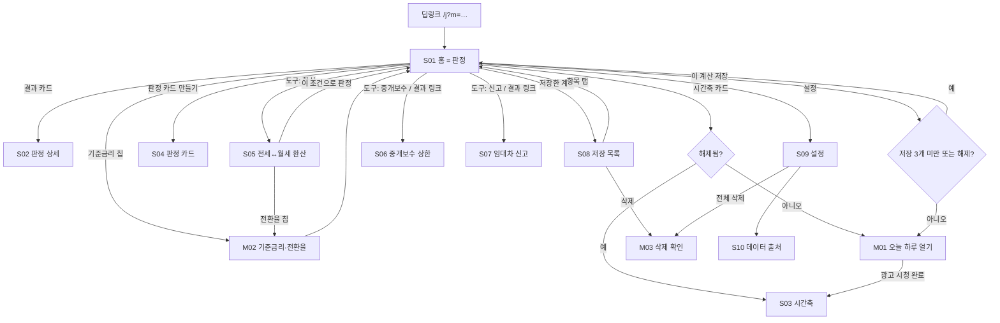

# 화면 흐름·와이어프레임 — rent-calc ("월세 이거 맞아?")

| 항목 | 내용 |
|---|---|
| 문서 버전 | v0.2 (2026-09-08) |
| 상위 문서 | [FUNCTIONAL_SPEC.md](FUNCTIONAL_SPEC.md) v0.2 (화면 ID·동작 규칙), [PRD.md](PRD.md) v0.2 (원칙 A·B·C·D) |
| 범위 | v1.0 전 화면. 와이어프레임은 저해상도(구조·우선순위·카피)만. 색·타이포는 net-pay 6장 토큰 공유 |
| 기준 뷰포트 | 360×780, 상단은 앱인토스 네비게이션 바 |

---

## 1. 네비게이션 맵



뒤로가기 규칙: S01에서 뒤로가기 = 미니앱 종료. S05·S06·S07은 S01의 형제 화면, 뒤로가기 = S01(S06·S07을 S01 결과 링크로 열었어도 S01). 나머지는 직전 화면. 바텀시트·다이얼로그에서 백 = 닫기. 광고 표시 중 백은 SDK가 처리.

---

## 2. 공통 레이아웃 규칙

### 2-1. 앱인토스 네비게이션 바
- 토스가 그리는 바 사용. 자체 헤더·뒤로가기 버튼 없음.
- 타이틀: S01 "월세 이거 맞아?", 그 외 화면 이름("판정 상세", "전세↔월세 환산", "중개보수 상한", "임대차 신고", "저장한 계산", "설정", "데이터 출처").

### 2-2. 세이프 에어리어·그리드
- 좌우 여백 20, 카드 간격 12, 카드 내부 16. 세로 스크롤 하나. 가로 스크롤 없음. 하단은 SDK 세이프 에어리어 값.
- 숫자 입력 화면(S01·S05·S06·S07)은 입력을 상단, 결과를 바로 아래. 배너는 스크롤 콘텐츠 마지막 요소.

### 2-3. 상태 변주(공통)
| 상태 | 표현 |
|---|---|
| 입력 없음 | 결과 카드 대신 예시 한 줄 (S01: "예) 지금 보증금 1억, 제안 보증금 5,000만 + 월세 25만") |
| 로딩 | 없음(계산 동기). 광고 로딩만 버튼 내 스피너 |
| 빈 상태 | 한 문장 + CTA 1개 |
| 오류 | 토스트 3초. 전체 오류는 데이터 로드 실패만 |
| 오프라인 | 광고 버튼에만 "인터넷 연결이 필요해요" |
| 잠금 | 헤드라인 보이고 수치 영역은 자리표시자(`●●●,●●●원`) + 🔒 "광고 보고 오늘 하루 열기". 실제 값은 DOM에 넣지 않음 |
| 데이터 오래됨 | 결과 카드 하단 `data.stale` 한 줄(기준금리 asOf 90일 초과) |

---

## 3. 화면별 와이어프레임

### S01 홈 = 판정

```
┌──────────────────────────────────┐
│ [ 갱신·기간 중 변경 ] [ 신규 계약 ] │  세그먼트, 기본 왼쪽 (원칙 B4)
├──────────────────────────────────┤
│ 지금 조건                          │  ← 신규 모드에서는 이 묶음 숨김
│  보증금 [ 10,000 ] 만 원            │
│  월세   [      0 ] 만 원  (0=전세)  │
│ 제안받은 조건                       │
│  보증금 [  5,000 ] 만 원            │
│  월세   [     25 ] 만 원            │
│ ⓘ 기준금리 3.00% · 전환율 5%  ▸     │  칩 → M02
│ ▸ 마지막 계약·증액일 (선택)          │  접힘
├──────────────────────────────────┤
│ ┃ 법정 상한을 월 20,833원 넘어요     │  결과 카드 (exceeds). within이면 "법정 상한 안이에요"
│ ┃ 환산 기준 인상률 10.00% (상한 5%) │
│ ┃ 제안 보증금 그대로면 월세는          │
│ ┃ 최대 229,166원까지예요             │
│ ┃ [산식 보기 ›]                     │  → S02
├──────────────────────────────────┤
│ 🔒 이 보증금, 2021년이었다면          │  시간축 카드(잠금/해제) → S03 / M01
├──────────────────────────────────┤
│ [ 판정 카드 만들기 ]  [ 이 계산 저장 ] │  → S04 / 저장
│ 이 계약의 중개보수 상한 ›  신고 대상인가요 › │  → S06 / S07 (제안 조건 전달)
├──────────────────────────────────┤
│ 도구:  환산  ·  중개보수  ·  신고  ·  저장  ·  설정 │
│ 기준: 주임법 제7조·제7조의2 · 기준금리 3.00% (2026-08-27 공시) │
│ 참고용 판정 문구(B1) · 입력한 금액은 이 기기 안에서만 계산돼요 │
│ [배너]                              │
└──────────────────────────────────┘
```

- 결과 카드 좌측 굵은 선 색: `within` = primary, `exceeds` = text 색(빨강 금지 — 증감·판정에 색 의미 없음, 배지 텍스트로 구분).
- 1년 미경과면 결과 카드 안에 한 줄 추가: `judge.oneYear`.
- 신규 모드 결과 카드: 헤드라인 `new.headline`, 본문 환산 참고치 2줄, 링크 2개(S06·S07). 배지·인상률 없음.
- 제안 보증금이 상한을 단독 초과(`maxRentForProposedDeposit === null`)면 3번째 줄은 "제안 보증금만으로 상한을 넘어요. 보증금은 최대 {maxDep}원까지예요".

### M02 기준금리·전환율 (바텀시트)

```
┌──────────────────────────────────┐
│ 기준금리·전환율                     │
│ 한국은행 기준금리  [ 3.00 ] %       │  번들값 표시, 직접 입력 가능
│ 2026-08-27 공시 기준 · [번들값으로]   │
│ 법정 전환율 = min(10%, 기준금리+2%) = 5.00% │  읽기 전용
│ (S05에서만) 참고 전환율 [ 5.00 ] %   │  직접 입력 시 라벨 "참고 전환율"
│ [ 적용 ]                            │
└──────────────────────────────────┘
```

### S02 판정 상세

```
│ 판정 상세                            │
│ 항목            지금        제안       │
│ 보증금      100,000,000  50,000,000   │
│ 월세                  0     250,000   │
│ 환산보증금  100,000,000 110,000,000   │  = 보증금 + 월세×12÷5%
│ 환산 인상률            +10.00%        │  상한 5%
│ 항목별 인상률  보증금 −50% · 월세 —    │  참고
│ 허용 환산보증금(+5%)   105,000,000    │
│ 초과분   환산 5,000,000 = 월세 20,833  │
│ 법정 최대치                          │
│  · 제안 보증금 그대로 → 월세 최대 229,166 │
│  · 제안 월세 그대로 → 보증금 최대 45,000,000 │
│ 적용 전환율 5.00% (기준금리 3.00%+2%, 상한 10%) │
│ 마지막 계약·증액일 2026-01-15 → 1년 미경과  │  입력 시만
│ ⓘ 신규 계약에는 이 상한이 적용되지 않아요   │
│ ⓘ 요구권을 행사한 갱신이면 5% 초과분은     │  B5 (exceeds 시만)
│   효력이 없고 반환 청구할 수 있어요         │
│ ⓘ 요구권 없이 합의한 새 계약이면 넘을 수 있어요 │
│ ⓘ 전세→월세 전환은 임차인 동의 필요 + 전환율 상한 │  전환 제안일 때만
│   상담: 임대차분쟁조정위원회 ›            │  공공 링크
│ 기준·면책(B1·B2)                        │
```

배너 없음.

### M01 오늘 하루 열기 (바텀시트)
net-pay M01과 동일 구조. 문구는 5장 `gate.*`. 상태: idle / loading / loaded / failed.

### S03 시간축

```
│ 이 보증금, 2021년이었다면              │
│ 보증금 50,000,000원을 전부 월세로 돌릴 때 법정 상한 │
│  ▁ ▂ ▆ ▇ ▆ ▅ ▇    막대 7개 (2021~2026 1/1 + 최신) │
│ 104,166 … 208,333                    │  값 라벨
│ 기준금리가 0.50%→3.00%로 바뀌어 같은 보증금의 │
│ 전환 상한이 매달 104,167원 달라졌어요    │  서술형
│ 연도  기준금리  전환율  상한 월세        │
│ 2021  0.50%   2.50%   104,166        │
│ …                                     │
│ 최신  3.00%   5.00%   208,333        │
│ ⓘ 5% 증액 상한은 연도와 관계없이 같아요  │
│ [ 카드로 공유 ]                        │  → S04 (timeline 변형)
│ 기준·면책                              │
```

배너 없음. 막대 단일색.

### S04 판정 카드

```
│ ┌────────────────────────────┐      │
│ │ 제안 조건, 법정 상한을        │      │  1080×1350 미리보기
│ │ 월 20,833원 넘어요           │      │
│ │ 보증금 5,000만 · 월세 25만 → +10.00% (상한 5%) │
│ │ 기준금리 3.00% · 전환율 5%   │      │
│ │ 참고용 판정 · 주택임대차보호법 기준 │
│ │ 월세 이거 맞아? · 토스에서 열기  intoss://rent-calc/j?… │
│ └────────────────────────────┘      │
│ [보증금 숨기기 ○]                     │
│ [ 이미지 저장 ]  [ 링크 공유 ]          │
```

배너 없음. within 변형은 헤드라인만 다름. 신규 모드 변형은 "신규 계약 환산 참고치" + 환산 2줄.

### S05 전세↔월세 환산

```
│ [ 보증금 → 월세 ] [ 월세 → 보증금 ]    │
│ 보증금 [ 10,000 ] 만 원                │
│ ⓘ 법정 전환율 5.00% ▸                  │  → M02, 직접 입력 시 "참고 전환율 4.50%"
│ ┃ 월세 416,666원                       │
│ ┃ 연 5,000,000원                       │
│ ⓘ 법정 상한(갱신·기간 중 전환 시)은 5.00%예요 │  참고 전환율 사용 시만
│ [ 이 조건으로 판정하기 ]                 │  → S01 제안 조건에 채움
│ 기준·면책 · [배너]                      │
```

### S06 중개보수 상한

```
│ 보증금 [  3,000 ] 만 원   월세 [ 50 ] 만 원 │
│ 오피스텔인가요?  ( ) 아니요 (주택)          │
│                  ( ) 예, 85㎡ 이하·전용 부엌·화장실·목욕시설 │
│                  ( ) 예, 그 외             │
│ ┃ 중개보수 상한 300,000원 (부가세 별도)    │
│ ┃ 거래금액 80,000,000 = 보증금 + 월세×100  │  ×70이면 "5천만 미만이라 ×70으로 다시 계산"
│ ┃ 상한요율 0.4% → 320,000 → 한도액 300,000 │
│ ⓘ 상한이에요. 실제 금액은 협의로 정해요.    │  사실 문구
│ ⓘ 지자체 조례에 따라 다를 수 있어요.       │
│ 기준: 공인중개사법 시행규칙 별표 1·2 (2021-10-19) │
│ [배너]                                   │
```

"그 외" 선택 시 결과 "0.9% 이내에서 협의 — 상한 {tx×0.9%}원". 매매 탭은 [P1].

### S07 임대차 신고

```
│ 보증금 [  7,000 ] 만 원   월세 [  0 ] 만 원 │
│ 계약일 [ 2026-09-01 ] (선택)               │
│ ┃ 신고 대상이에요                          │  / "신고 대상이 아니에요"
│ ┃ 보증금이 6,000만 원을 넘어요              │  이유
│ ┃ 신고 기한 2026-10-01 (계약일부터 30일)    │  계약일 입력 시
│ ⓘ 임대인·임차인 중 한 명이 신고하면 돼요.    │
│   주민센터 방문 또는 부동산거래관리시스템(공공) › │
│ ⓘ 지연·미신고 2만~30만 원, 허위 신고 최대 100만 원 과태료 │
│ ⓘ 일부 지역(군 등)은 대상이 아닐 수 있어요.  │
│ 기준 · [배너]                              │
```

### S08 저장 목록
```
│ [갱신] 보증금 1억 → 5,000만 · 월세 0 → 25만   상한 초과  09-08 │
│ [신규] 보증금 8,000만 · 월세 30만            환산       09-07 │
│ (3/3) 더 저장하려면 🔒 오늘 하루 열기          │
│ [배너]                                       │
```
항목 탭 → S01 복원(모드 포함). 항목 롱프레스/메뉴 → 삭제(M03 1단계).

### M03 삭제 확인
net-pay와 동일. 전체 삭제는 2단계.

### S09 설정
```
│ 기준금리   3.00% (2026-08-27 공시)   [직접 입력] [초기화] │
│ 데이터 출처·기준일 ›                                    │
│ 저장한 계산 전체 삭제                                    │
│ 고객문의  support@…                                     │
│ 같은 개발자의 다른 미니앱: 세후로 말해줘 › 그때 환전했다면 › │
│ 국토교통부·한국은행이 제공·인증한 서비스가 아닙니다.        │
```

### S10 데이터 출처
세 데이터 파일 `meta` 렌더: 정식 명칭, URL, 수집일·확인일, 다음 갱신 안내. ECOS 출처 표시 형식 그대로.

---

## 4. 핵심 플로우 시퀀스

### 4-1. 판정 → 상세 (해피 패스)
1. S01 진입(모드 renew, lastInput 복원). 2. 제안 월세 입력 → 300ms 후 결과 카드 `exceeds`. 3. "산식 보기" → S02. 4. 뒤로 → S01.

### 4-2. 시간축 게이트 → 광고 → S03 → 카드 공유
1. 잠금 카드 탭 → `gate_view{timeline}` → M01. 2. "광고 보고 열기" → `showRewarded` → `onReward` → `unlock.until` 저장 → 토스트 → S03. 3. "카드로 공유" → S04(timeline 변형) → 링크 공유.

### 4-3. 신규 모드
1. 세그먼트 "신규 계약" → 지금 조건 묶음 접힘, 결과 카드 `new.headline`. 2. "중개보수 상한 보기" → S06(보증금·월세 전달). 3. 뒤로 → S01.

### 4-4. 저장 4개째
1. "이 계산 저장" → scenarios.length 3, 잠금 → M01. 2. 시청 완료 → 저장 → 토스트 `save.done (4/20)`.

### 4-5. 딥링크 진입
`intoss://rent-calc/j?m=renew&cd=100000000&cr=0&pd=50000000&pr=250000` → S01 모드·입력 채움 → 결과 카드 즉시. 잘못된 값은 무시하고 빈 폼.

---

## 5. 카피 일람 (린트 대상, 확정 문구)

| 키 | 문구 | 비고 |
|---|---|---|
| app.title | 월세 이거 맞아? | |
| mode.renew / mode.new | 갱신·기간 중 변경 / 신규 계약 | |
| input.current / input.proposed | 지금 조건 / 제안받은 조건 | |
| input.deposit / input.rent | 보증금 / 월세 | 단위 "만 원", 힌트 "0 = 전세" |
| input.lastChange | 마지막 계약·증액일 (선택) | |
| rate.chip | 기준금리 {br}% · 전환율 {rate}% | |
| rate.legalFormula | 법정 전환율 = 10%와 기준금리+2% 중 낮은 값 | |
| rate.reference | 참고 전환율 {rate}% | 사용자 입력 시 |
| rate.legalNote | 법정 상한(갱신·기간 중 전환 시)은 {legal}%예요 | |
| judge.within | 법정 상한 안이에요 | |
| judge.exceeds | 법정 상한을 월 {excess}원 넘어요 | |
| judge.increase | 환산 기준 인상률 {inc}% (상한 5%) | |
| judge.maxRent | 제안 보증금 그대로면 월세는 최대 {max}원까지예요 | |
| judge.maxDeposit | 제안 보증금만으로 상한을 넘어요. 보증금은 최대 {max}원까지예요 | maxRent null 시 |
| judge.oneYear | 직전 계약·증액 후 1년이 지나지 않아 증액 청구가 제한돼요 | |
| judge.consentRenewal | 계약갱신요구권을 행사한 갱신이면 5%를 넘는 부분은 효력이 없고, 넘게 낸 금액은 반환을 청구할 수 있어요 | B5, 해설집 FAQ Q3-1 |
| judge.consentNew | 요구권을 행사하지 않고 합의한 새 계약이면 5%를 넘을 수 있어요. 요구권은 나중에 1회 쓸 수 있어요 | B5, 해설집 FAQ Q3 |
| judge.consult | 자세한 상담은 임대차분쟁조정위원회에서 | 공공 링크 |
| judge.conversionConsent | 갱신할 때 전세를 월세로 바꾸는 건 임차인이 동의해야 하고, 동의해도 전환율 상한이 적용돼요 | 해설집 전월세 전환 Q1, 전환 제안일 때만 |
| judge.notNew | 신규 계약에는 이 상한이 적용되지 않아요 | |
| new.headline | 신규 계약에는 법정 상한이 없어요 | B4 |
| new.body | 보증금 {d}원 = 월세 {r}원 (전환율 {rate}% 기준 참고치) | |
| new.note | 계약 후 갱신·증액 때는 5%·전환율 상한이 적용돼요 | |
| timeline.card.title | 이 보증금, 2021년이었다면 | |
| timeline.sub | 보증금 {d}원을 전부 월세로 돌릴 때 법정 상한 | |
| timeline.headline | 기준금리가 {r0}%→{r1}%로 바뀌어 같은 보증금의 전환 상한이 매달 {delta}원 달라졌어요 | 서술형, 부호만 |
| timeline.capNote | 5% 증액 상한은 연도와 관계없이 같아요 | |
| gate.title | 오늘 하루 열기 | |
| gate.body | 광고를 보면 오늘 자정까지 시간축 비교와 저장 20개를 쓸 수 있어요. | |
| gate.cta / gate.later | 광고 보고 열기 / 다음에 | |
| gate.unlocked.toast | 오늘 자정까지 열렸어요 | |
| ad.unavailable | 지금은 광고를 불러올 수 없어요. 잠시 후 다시 시도해 주세요 | |
| card.within / card.exceeds | 제안 조건, 법정 상한 안이에요 / 제안 조건, 법정 상한을 월 {excess}원 넘어요 | |
| card.line.terms | 보증금 {pd}만 원 · 월세 {pr}만 원 → {inc}% (상한 5%) | 숨김 시 보증금 ●●●● |
| card.line.rate | 기준금리 {br}% · 전환율 {rate}% | |
| card.disclaimer | 참고용 판정 · 주택임대차보호법 기준 | |
| card.footer | 월세 이거 맞아? · 토스에서 열기 | |
| card.hideDeposit | 보증금 숨기기 | |
| card.share.text | 제안 월세 {pr}만 원, 법정 상한 {verdictText} (참고용 판정) | |
| broker.officetel.q | 오피스텔인가요? | |
| broker.officetel.no / .qualified / .other | 아니요 (주택) / 예, 85㎡ 이하·전용 부엌·화장실·목욕시설 / 예, 그 외 | |
| broker.result | 중개보수 상한 {fee}원 (부가세 별도) | |
| broker.tx | 거래금액 {tx}원 = 보증금 + 월세×{mult} | |
| broker.tx70 | 5천만 원 미만이라 월세×70으로 다시 계산했어요 | |
| broker.capApplied | 상한요율 {ratio}% → {raw}원 → 한도액 {cap}원 | |
| broker.negotiable | 0.9% 이내에서 협의해요. 상한 {fee}원 | other |
| broker.isCap | 상한이에요. 실제 금액은 협의로 정해요. | |
| broker.ordinance | 지자체 조례에 따라 다를 수 있어요. | |
| report.required / report.notRequired | 신고 대상이에요 / 신고 대상이 아니에요 | |
| report.reason.deposit / .rent | 보증금이 6,000만 원을 넘어요 / 월세가 30만 원을 넘어요 | |
| report.deadline | 신고 기한 {date} (계약일부터 30일) | |
| report.overdue | 신고 기한이 지났어요. 지연 신고도 가능해요 | |
| report.who | 임대인·임차인 중 한 명이 신고하면 돼요. 주민센터 방문 또는 부동산거래관리시스템 | |
| report.fine | 지연·미신고 2만~30만 원, 허위 신고 최대 100만 원 과태료 | |
| report.region | 일부 지역(군 등)은 대상이 아닐 수 있어요. | |
| save.cta / save.done / save.capReached | 이 계산 저장 / 저장했어요 ({n}/{cap}) / 최대 20개까지 저장할 수 있어요 | |
| privacy.line | 입력한 금액은 이 기기 안에서만 계산돼요. | C4 |
| basis.judge | 기준: 주택임대차보호법 제7조·제7조의2 · 기준금리 {br}% ({asOf} 한국은행 공시) | B2 |
| basis.override | (직접 입력한 기준금리) | override 시 |
| basis.broker | 기준: 공인중개사법 시행규칙 별표 1·2 (2021-10-19) | |
| disclaimer.full | 주택임대차보호법·공인중개사법 수치 기준 참고용 판정입니다. 개별 계약·특약·조례에 따라 다를 수 있어요. | B1 |
| data.stale | 기준금리가 {asOf} 이후 바뀌었을 수 있어요. 설정에서 직접 입력할 수 있어요 | |
| sources.notAffiliated | 국토교통부·한국은행이 제공·인증한 서비스가 아닙니다. | |

---

## 6. 디자인 토큰
net-pay SCREEN_FLOW 6장 토큰을 그대로 공유한다. 추가 없음. 판정 결과에 색 의미를 두지 않는다(`within`·`exceeds` 모두 text 색, 배지 텍스트로 구분).

---

## 7. 컴포넌트 인벤토리

| 컴포넌트 | 사용 화면 | 상태 | 출처 |
|---|---|---|---|
| `ModeSegment` | S01 | renew / new | 신규 |
| `MoneyInput` | S01 S05 S06 S07 | empty / filled / invalid | net-pay 재사용 |
| `TermsGroup` (보증금+월세 묶음) | S01 S06 S07 | — | 신규 |
| `RateChip` + `RateSheet`(M02) | S01 S05 | legal / override | 신규 |
| `VerdictCard` | S01 | empty / within / exceeds / new | 신규 |
| `FormulaTable` | S02 | — | net-pay `DeductionTable` 변형 |
| `LockedCard` | S01 S08 | locked / unlocked | net-pay 재사용 |
| `BarChart` (막대 7개) | S03 S04 | — | net-pay 재사용 |
| `ShareCard` (캔버스 1080×1350) | S04 | within / exceeds / new / timeline | net-pay `NegotiationCard` 구조 |
| `GateSheet`(M01) | 전역 | idle / loading / loaded / failed | net-pay 재사용 → kit 이동 후보 |
| `RadioGroup` (오피스텔 3상태) | S06 | — | 신규 |
| `DateInput` | S01(접힘) S07 | — | net-pay 재사용 |
| `BannerAd` | S01 S05 S06 S07 S08 | — | kit |
| `ConfirmDialog`(M03) | S08 S09 | 1단계 / 2단계 | net-pay 재사용 |
| `BasisFooter` | 결과 화면 전부 | — | net-pay 재사용(문구 주입) |
| `Toast` | 전역 | — | 재사용 |

`LockedCard`·`GateSheet`·`BasisFooter`·`MoneyInput`·`BarChart`가 세 앱에서 반복되면 `@ait/kit`에 UI 패키지를 두는 것을 검토(SHARED_PACKAGE 오픈 이슈로 넘김).

---

## 8. 오픈 이슈 (화면)

| ID | 내용 | 해결 시점 |
|---|---|---|
| O-8 | S01에 "지금 조건 / 제안받은 조건" 두 묶음(입력 4개)이 첫 화면으로 무겁지 않은지. 대안: 제안 조건만 먼저 받고 "지금 조건" 접기. 프로토타입 5명 관찰 | W2 |
| O-9 | 세그먼트 기본값이 "갱신"인데 신규 계약 사용자가 잘못 판정받는 경로. 첫 진입 시 한 번 "어떤 상황인가요?" 선택 시트를 띄울지 | W2 |
| O-10 | 예시 수치는 레이아웃용. 기준금리 최신값(O-3) 확정 후 문서 수치 갱신 | W1 |

## 9. 변경 이력
- 2026-09-08 v0.1 초안. 화면 10 + 시트 3. 비교 화면 없음, 오피스텔 3상태 라디오, 신규 모드 분리 표현.
- 2026-09-08 v0.2 S02·카피에 B5 정밀화(요구권 행사 여부별 효력, 전환 동의) 반영.
