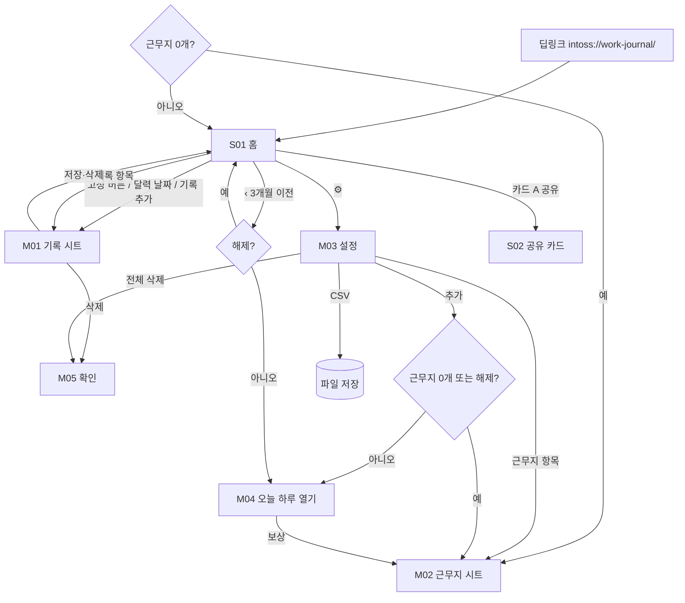

# 화면 흐름·와이어프레임 — work-journal ("근무수첩")

| 항목 | 내용 |
|---|---|
| 문서 버전 | v0.2 (2026-09-09) |
| 상위 문서 | [FUNCTIONAL_SPEC.md](FUNCTIONAL_SPEC.md) v0.1 — 화면 ID(S·M) 동일 |
| 근거 | [LEGACY_SCREENS.md](LEGACY_SCREENS.md) — 구판 구조를 유지하고 광고·kit 규칙만 얹는다 |
| 디자인 토큰 | net-pay [SCREEN_FLOW 6장](../../net-pay/docs/SCREEN_FLOW.md) 공유. 강조색만 이 앱 것(6장) |
| 다음 단계 | **화면 시안(캔버스) → 승인 → 구현** (PLAYBOOK 2-10). 이 문서는 시안의 입력이다 |

---

## 1. 네비게이션 맵

**홈 한 화면 + 시트.** 탭바 없음(구판과 같다). 상단 바는 토스가 그린다.



**뒤로가기**: 시트·다이얼로그 열림 → 닫기. S02 → S01. S01 → 미니앱 종료. 광고 표시 중은 SDK.

**시트 닫는 방법 셋**: 뒤로가기 · 딤 영역 탭 · **아래로 끌어내리기**(96px 또는 빠른 튕김).
드래그는 손잡이와 제목 줄에서만 시작한다 — 본문에서 끌면 스크롤과 다투고, 스크롤 도중에 시트가 닫히는 사고가 난다.

---

## 2. 공통 레이아웃 규칙

### 2-1. 네비게이션 바
토스 바(`withBackButton, withHomeButton, withTitle`, 라이트). 타이틀 "근무수첩". 자체 헤더 없음.

### 2-2. 세이프 에어리어·그리드
- CSS `env()` 금지. kit `useSafeArea()` 의 `--safe-top`/`--safe-bottom` 만 쓴다(net-pay 2-2 와 같은 이유).
- 좌우 20, 카드 간격 12, 카드 내부 16. 세로 스크롤 하나.
- **고정 버튼 + 배너**: 고정 버튼(높이 56 + `--safe-bottom`)은 뷰포트 하단. 배너는 스크롤 콘텐츠 마지막이며 스크롤 컨테이너 하단 패딩 = 버튼 높이 + 12. 그래야 끝까지 내렸을 때 배너가 버튼 뒤에 숨지 않는다. **시안에서 실측 확인.**
- 시트는 하단에서 올라오고 최대 높이 92vh, 내부 스크롤. 시트 바닥에 저장 버튼 고정(`--safe-bottom` 포함).

### 2-3. 상태 변주
| 상태 | 표현 |
|---|---|
| 기록 0건 | 카드 A `0원`, 카드 B 전부 0, 목록 빈 상태 "아직 기록이 없어요 / 달력에서 날짜를 누르거나 아래 버튼으로 추가해 보세요." |
| 근무지 0개 | 부트 시 M02 자동 오픈(유일한 자동 오픈). 닫으면 홈이 보이고 **하단 고정 버튼이 [근무지 등록하기] 로 바뀐다**. 버튼을 비활성으로 두면 왜 안 되는지 알 수 없으니 할 수 있는 일로 바꿔 준다 |
| 잠김(월) | 카드 A·B 수치 자리 뼈대 막대 + 🔒 "광고 보고 오늘 하루 열기". 달력·목록 대신 잠금 안내 카드 |
| 잠김(근무지) | 목록·설정에서 이름 옆 🔒, 합계 제외 안내 한 줄 |
| 주휴 미확정 | 카드 B 회색 행 "이번 주 주휴 예정 +{n}원 · 일요일이 지나면 확정" |
| 오프라인 | 광고 버튼만 "인터넷 연결이 필요해요" |
| 오류 | 토스트 3초 |

---

## 3. 화면별 와이어프레임

### S01 홈
```
┌──────────────────────────────────┐
│ ‹  근무수첩                  ⋯ ✕ │  토스 바
├──────────────────────────────────┤
│   ‹   2026년 9월   ›         ⚙   │  월 네비 + 설정
│ ┏━━━━━━━━━━━━━━━━━━━━━━━━━━━━━━┓ │
│ ┃ 이번 달 예상 실수령액   [공유]┃ │  카드 A (강조색 면)
│ ┃ 132,765원                    ┃ │  42px
│ ┃ ───────────────────────────  ┃ │
│ ┃ 세전 급여  │ 주휴수당 │ 예상 공제┃ │
│ ┃ 165,120원  │ 0원      │ -32,355원┃ │
│ ┗━━━━━━━━━━━━━━━━━━━━━━━━━━━━━━┛ │
│ ┌──────────────────────────────┐ │
│ │ ▣ 급여 계산      16시간 · 2일 │ │  카드 B
│ │ 근무 급여            165,120원│ │
│ │ 가산(연장·야간·휴일)      +0원│ │  >0 일 때만
│ │ 주휴수당 0회             +0원│ │
│ │ 이번 주 주휴 예정  +33,024원  │ │  회색, 조건부
│ │ ────────────────────────────│ │
│ │ 세전 급여            165,120원│ │
│ │ 소득세·지방소득세         -0원│ │
│ │ 4대보험 근로자 부담분 -32,355원│ │
│ │ ┌─────────────────────────┐ │ │
│ │ │ 예상 실수령액   132,765원│ │ │  강조 박스
│ │ └─────────────────────────┘ │ │
│ │ 예상액이며 실제 급여명세서와… │ │  면책 13px
│ └──────────────────────────────┘ │
│ ┌──────────────────────────────┐ │
│ │ ▦ 근무 달력          기록 추가│ │  카드 C
│ │ 일 월 화 수 목 금 토          │ │
│ │        1  2  3  4  5          │ │
│ │  6  7  8 (9) 10 11 12         │ │  오늘 = 강조 원
│ │        •  •                   │ │  근무지 색 점
│ │      83천 83천                │ │  금액 축약
│ │ …                             │ │
│ └──────────────────────────────┘ │
│ ┌──────────────────────────────┐ │
│ │ ≡ 근무 기록                2건│ │  카드 D
│ │ • 9월 9일 (수)       82,560원 │ │
│ │   테스트 · 09:00–18:00 · 8시간│ │
│ │ • 9월 8일 (화)       82,560원 │ │
│ └──────────────────────────────┘ │
│ [ 배너 ]                         │  스크롤 마지막
│                                  │
│ ┃      + 근무 기록하기         ┃ │  고정 버튼 (근무지 0개면 [근무지 등록하기])
└──────────────────────────────────┘
```
- 카드 A 가 화면에서 가장 큰 글자. 구판과 같은 자리·같은 문구.
- 카드 B 행은 값이 0 이어도 구판처럼 **항상 표시**(구조가 곧 설명). 가산 행만 >0 조건부.
- 달력 금액 축약: **`<10만 → n천`**(구판이 82,560원을 `83천` 으로 적었다), `<100만 → n.n만`, 그 이상 `n만`.

### M01 기록 시트
```
┌──────────────────────────────────┐
│ 닫기          근무 기록          │
│ 근무지            [테스트      ▾]│  1개면 숨김
│ 날짜              [2026. 09. 01 ▾]│
│ 출근 [오전 9:00 ▾]  퇴근 [오후 6:00 ▾]│
│                        다음 날 ●  │  자정 넘김 배지
│ 휴게시간 [60    분] 추가수당 [0  원]│
│ ┌──────────────────────────────┐ │
│ │ 휴일 근무                  ☐ │ │
│ │ 5인 이상 설정에서 휴일 가산… │ │
│ └──────────────────────────────┘ │
│ 메모 선택  [예: 마감 근무        ]│
│ ┌──────────────────────────────┐ │
│ │ 실근무               8시간    │ │  미리보기
│ │ 기본급            82,560원    │ │
│ │ 야간 180분        +15,480원   │ │  조건부
│ │ ──────────────────────────── │ │
│ │ 예상 급여          98,040원   │ │  강조 26px
│ └──────────────────────────────┘ │
│ 야간은 22:00~06:00 기준이며 휴게… │  각주
│ 5인 미만 사업장은 가산이 붙지…    │  조건부 각주
│ ┃        근무 기록 저장        ┃ │  고정
│ (수정 시)  기록 삭제              │  텍스트 버튼
└──────────────────────────────────┘
```

### M02 근무지 시트
구판 필드 순서 그대로(LEGACY 2-5). 섹션 3개: **기본**(이름·시급·규모·급여일) / **근로·세금 구분**(소득 유형·주휴 토글) / **세금·4대보험**(employee 만 펼침: 가족·자녀·비과세·비율·보험 3토글·신고 보수) / **표시 색상** / [근무지 저장] / (수정) 근무지 삭제. 시급 각주 `{Y}년 최저임금은 시간당 {n}원이에요` — 시급이 그 아래면 강조색(판정 문구 없음).

### M03 설정 시트
```
│ 닫기            설정             │
│ 근무지                     추가  │
│ ┌ ● 테스트                    › ┐│
│ │  일반 근로 · 시급 10,320원 · 매월 10일 ││
│ 내 데이터                        │
│  CSV 로 기록 내보내기          › │
│  전체 삭제                     › │  위험색 텍스트
│  근무지와 근무 기록은 외부 서버로…│  각주(구판)
│ ┌ 계산 기준 ───────────────────┐ │
│ │ 2026년 최저임금, 근로기준법의 │ │  구판 문구, 연도는 데이터
│ │ 주휴·가산 기준, 국세청 간이세액표│ │
│ │ (2026-03-01 시행), 2026년 사회보험│ │
│ │ 료율을 참고해요. 계산값은 … 법적 │ │
│ │ 증빙은 아니에요.               │ │
│ └──────────────────────────────┘ │
│ 출처 보기 › · 고객문의 › · 다른 앱 ›│
│ 버전 1.0.0                        │
```

### M04 오늘 하루 열기 (바텀시트)
제목 "오늘 하루 열기" / 본문 "광고를 보면 오늘 자정까지 근무지를 여러 개 쓰고 지난 기록을 볼 수 있어요." / [광고 보고 열기] [다음에]. 로딩은 버튼 안 스피너.

### M05 확인 다이얼로그
기록 삭제: "이 기록을 지울까요?" / 근무지 삭제: "{이름}과 기록 {n}건을 지울까요?" / 전체 삭제 2단계: "모든 근무지와 기록을 지울까요?" → "지운 데이터는 되돌릴 수 없어요. CSV 로 먼저 내보내는 것을 권해요." [내보내기] [지우기].

### S02 공유 카드
```
│ ‹  공유 카드                      │
│ ┌──────────── 미리보기 ─────────┐ │  1080×1350 축소
│ │  9월, 16시간 일하고            │ │
│ │  예상 실수령                   │ │
│ │  132,765원                     │ │
│ │  세전 165,120원 · 주휴 0회 · 근무지 1곳││
│ │  예상액 · 근로기준법·간이세액표 기준││
│ │  근무수첩 · 토스에서 열기       │ │
│ └───────────────────────────────┘ │
│ 금액 숨기기                    ◯  │
│ [ 이미지 저장 ]  [ 링크 공유 ]     │
```

---

## 4. 핵심 플로우 시퀀스

### 4-1. 첫 사용 (해피 패스)
진입 → 근무지 0개 → M02 자동 오픈(시급 10,320 기본) → 저장 → S01(0원) → 고정 버튼 → M01(오늘, 09:00~18:00, 60분 기본) → 미리보기 82,560 → 저장 → S01 카드 A 갱신 · 달력 점 · 목록 1건.

### 4-2. 야간 기록
M01 출근 18:00 퇴근 02:00 → "다음 날" 배지 → 미리보기 실근무 7시간 · 야간 180분(5인 이상이면 +15,480) → 저장 → 달력에는 **출근 날짜**에 점.

### 4-3. 두 번째 근무지 (게이트)
M03 [추가] → 잠김 → M04 → 광고 → 보상 → M02 → 저장 → 토스트 "오늘 자정까지 열렸어요". 다음 날 → 두 번째 근무지 🔒, 합계에서 제외, 기록은 유지.

### 4-4. CSV
M03 [CSV 로 기록 내보내기] → `File.saveBase64` → 토스트 "근무수첩_20260909.csv 를 저장했어요" (미지원 기기: 클립보드 폴백 토스트).

---

## 5. 카피 일람 (린트 대상, 확정 문구)

구판 문구는 `구판` 표시 — 그대로 쓴다.

| 키 | 문구 | 비고 |
|---|---|---|
| app.title | 근무수첩 | |
| home.month | {y}년 {m}월 | |
| home.net.title | 이번 달 예상 실수령액 | 구판 |
| home.net.title.past | {m}월 예상 실수령액 | 지난 달 조회 시 |
| home.net.gross / .weekly / .deduct | 세전 급여 / 주휴수당 / 예상 공제 | 구판 |
| home.calc.title | 급여 계산 | 구판 |
| home.calc.meta | {h}시간 · {d}일 | 구판 |
| home.calc.workPay | 근무 급여 | 구판 |
| home.calc.added | 가산(연장·야간·휴일) | 신규, >0 조건부 |
| home.calc.weekly | 주휴수당 | 구판 · `{n}회` |
| home.calc.weeklyPending | 이번 주 주휴 예정 · 일요일이 지나면 확정 | 신규 |
| home.calc.gross | 세전 급여 | 구판 |
| home.calc.tax | 소득세·지방소득세 | 구판 |
| home.calc.insurance | 4대보험 근로자 부담분 | 구판 |
| home.calc.net | 예상 실수령액 | 구판 |
| home.calendar.title / .add | 근무 달력 / 기록 추가 | 구판 |
| home.records.title / .count | 근무 기록 / {n}건 | 구판 |
| home.records.empty.title | 아직 기록이 없어요 | 구판 |
| home.records.empty.body | 달력에서 날짜를 누르거나 아래 버튼으로 추가해 보세요. | 구판 |
| home.cta | 근무 기록하기 | 구판 |
| home.noWorkplace.cta | 근무지 등록하기 | 근무지가 0개일 때 하단 고정 버튼이 이 문구로 바뀐다 |
| record.title | 근무 기록 | 구판 |
| record.workplace / .date / .start / .end | 근무지 / 날짜 / 출근 / 퇴근 | 구판 |
| record.break / .extra | 휴게시간 / 추가수당 | 구판, 단위 분·원 |
| record.nextDay | 다음 날 | 신규 |
| record.holiday.title | 휴일 근무 | 구판 |
| record.holiday.sub | 5인 이상 설정에서 휴일 가산 참고액을 계산해요. | 구판 |
| record.memo / .memo.placeholder | 메모 (선택) / 예: 마감 근무 | 구판 |
| record.preview.work / .base / .overtime / .night / .holiday / .extra / .total | 실근무 / 기본급 / 연장 {m}분 / 야간 {m}분 / 휴일 / 추가수당 / 예상 급여 | 구판+신규 |
| record.note.night | 야간은 22:00~06:00 기준이며 휴게시간은 야간 구간에서 먼저 차감해 보수적으로 계산해요. | 구판 |
| record.note.under5 | 5인 미만 사업장은 가산이 붙지 않아요. 야간 {n}분 · 연장 {m}분은 참고로만 표시해요. | 신규 |
| record.save / .delete | 근무 기록 저장 / 기록 삭제 | 구판 |
| record.err.sameTime | 출근과 퇴근이 같아요 | 신규 |
| record.err.breakTooLong | 휴게시간이 근무시간보다 길어요 | 신규 |
| wp.title.new / .edit | 근무지 등록 / 근무지 수정 | 구판 |
| wp.name / .name.placeholder | 근무지 이름 / 예: 카페 오후 | 구판 |
| wp.wage / wp.wage.note | 시급 / {y}년 최저임금은 시간당 {n}원이에요. | 구판 |
| wp.size / .size.under / .size.over / .size.note | 사업장 규모 / 5인 미만 / 5인 이상 / 5인 이상을 선택하면 야간·연장·휴일 가산 참고액을 계산해요. | 구판 |
| wp.payday | 급여일 | 구판 |
| wp.section.income / wp.incomeType | 근로·세금 구분 / 소득 유형 | 구판 |
| wp.income.employee / .daily / .business | 일반 근로 / 일용 근로 / 사업소득 | 구판 |
| wp.income.note | 근로계약을 맺고 일한다면 일반 또는 일용 근로소득을 선택해요. | 구판 |
| wp.section.weekly / wp.weekly.title | 주휴수당 / 주휴수당 자동 계산 | 구판 |
| wp.weekly.sub | 주 15시간 이상이고 기록한 날을 모두 출근한 주를 계산해요. | 구판 수정("소정근로일"→"기록한 날") |
| wp.section.tax / .tax.hint | 세금·4대보험 / 일반 근로일 때만 보여요 | 구판 / 신규 |
| wp.dependents / .children / .nonTax | 공제대상 가족 (본인 포함) / 8~20세 자녀 / 월 비과세 급여 (선택) | 구판 |
| wp.taxRatio | 간이세액표 원천징수 비율 | 구판 |
| wp.nps / .nps.sub | 국민연금 / {y}년 근로자 부담률 {r}% | 구판, 수치는 데이터 |
| wp.nhis / .nhis.sub | 건강보험·장기요양 / 건강보험 {r}%와 장기요양보험 | 구판 |
| wp.ei / .ei.sub | 고용보험 / 근로자 실업급여 보험료 {r}% | 구판 |
| wp.reported / .reported.placeholder | 월 보험 신고 보수 (선택) / 0이면 예상 세전 급여 사용 | 구판 |
| wp.reported.note | 급여명세서의 기준소득월액·보수월액을 알면 입력해 주세요. 산재보험은 사업주 전액 부담이라 공제하지 않아요. | 구판 |
| wp.color | 표시 색상 | 구판 |
| wp.save / .delete | 근무지 저장 / 근무지 삭제 | 구판 |
| settings.title / .workplaces / .add | 설정 / 근무지 / 추가 | 구판 |
| settings.wp.sub | {incomeType} · 시급 {n}원 · 매월 {d}일 | 구판 |
| settings.data / .csv / .clear | 내 데이터 / CSV로 기록 내보내기 / 전체 삭제 | 구판+신규 |
| settings.data.note | 근무지와 근무 기록은 외부 서버로 전송하지 않고 이 기기에만 저장해요. 앱 데이터가 삭제될 수 있으니 필요한 기록은 주기적으로 내보내 주세요. | 구판 |
| settings.basis.title | 계산 기준 | 구판 |
| settings.links / settings.version | 출처 보기 · 고객문의 · 다른 앱 / 버전 {v} | |
| settings.basis.body | {y}년 최저임금, 근로기준법의 주휴·가산 기준, 국세청 간이세액표({eff} 시행), {y}년 사회보험료율을 참고해요. 계산값은 급여 확인을 위한 예상액이며 법적 증빙은 아니에요. | 구판+시행일 |
| disclaimer.short | 예상액이며 실제 급여명세서와 다를 수 있어요. | 카드 B 하단 |
| gate.title / .body / .cta / .later | 오늘 하루 열기 / 광고를 보면 오늘 자정까지 근무지를 여러 개 쓰고 지난 기록을 볼 수 있어요. / 광고 보고 열기 / 다음에 | |
| gate.unlocked.toast | 오늘 자정까지 열렸어요 | |
| gate.locked.workplace | 잠김 · 합계에서 제외돼요 | |
| ad.unavailable | 지금은 광고를 불러올 수 없어요. 잠시 후 다시 시도해 주세요 | |
| csv.done / .clipboard / .empty | {file}를 저장했어요 / CSV를 클립보드에 복사했어요 / 내보낼 기록이 없어요 | |
| card.headline | {m}월, {h}시간 일하고 | |
| card.net / .netHidden | 예상 실수령 {n}원 / {h}시간 일했어요 | |
| card.meta | 세전 {g}원 · 주휴 {c}회 · 근무지 {k}곳 | 숨김 시 제거 |
| card.disclaimer / .footer / .hide | 예상액 · 근로기준법·간이세액표 기준 / 근무수첩 · 토스에서 열기 / 금액 숨기기 | |
| confirm.record / .workplace / .all1 / .all2 | 이 기록을 지울까요? / {name}과 기록 {n}건을 지울까요? / 모든 근무지와 기록을 지울까요? / 지운 데이터는 되돌릴 수 없어요. CSV로 먼저 내보내는 것을 권해요. | |

---

## 6. 디자인 토큰
net-pay 6장 토큰(회색 계단·글자 크기·모서리·그림자·움직임·규칙 8개)을 그대로 쓴다. 다른 점 하나:

| 토큰 | 값 | 이유 |
|---|---|---|
| `--primary` / `--primary-press` / `--primary-weak` | **#6b5ce7 / #5646d1 / #efecfd** (보라) | 콘솔 등록 로고가 보라. 구판 카드 A·버튼도 보라였다. 토스 파랑을 쓰면 로고와 앱이 다른 앱처럼 보인다 |
| 근무지 색 5종 | purple #6b5ce7 · blue #3182f6 · green #12b886 · orange #f2994a · red #f0506e | 구판 스와치 5개. 달력 점·목록 점·설정 목록에만 쓴다 |

카드 A 는 `--primary` 면 위에 흰 글자(구판). 카드 B 의 실수령 박스는 `--primary-weak` 면 + `--primary` 글자. 증감 부호는 텍스트(`+`, `-`)로만.

**시안 단계에서 정할 것**: 카드 A 그라데이션 유무, 달력 셀 높이(금액 축약이 들어가므로 44 이상), 고정 버튼과 배너의 실측 간격.

---

## 7. 컴포넌트 인벤토리

| 컴포넌트 | 화면 | 상태 | 출처 |
|---|---|---|---|
| `MonthNav` | S01 | free / lockedNext | 신규 |
| `NetCard`(카드 A) | S01 | zero / value / locked | 신규 |
| `PayBreakdown`(카드 B) | S01 | 행 조건부 | net-pay `DeductionTable` 구조 참고 |
| `MonthCalendar` | S01 | 점·금액·오늘·잠김 | 신규 |
| `RecordList` | S01 | empty / list | 신규 |
| `Sheet` (하단, 92vh, 고정 푸터) | M01~M04 | | photo-standard 시트 재사용 |
| `TimeField` / `MinuteField` / `MoneyField` | M01 M02 | empty / invalid | net-pay `MoneyInput` 변형 |
| `Segment` (2·3 옵션) | M02 | | net-pay 모드 세그먼트 |
| `ToggleCard` (제목·부제·체크) | M01 M02 | | 신규 |
| `ColorSwatches` | M02 | | 신규 |
| `PreviewBox` | M01 | 행 조건부 | 신규 |
| `LockedPlaceholder`(뼈대 막대 + 🔒) | S01 | | net-pay 규칙 |
| `GateSheet`(M04) | 전역 | idle/loading/loaded/failed | kit ads + net-pay |
| `ConfirmDialog`(M05) | 전역 | 1단계/2단계 | net-pay |
| `ShareCardCanvas` | S02 | default / hideMoney | net-pay `drawCard` 구조 |
| `BannerAd` | S01 | | kit |
| `Toast` | 전역 | | 재사용 |
| `Icon` (인라인 SVG) | 전역 | | net-pay 규칙 — 이모지 금지 |

---

## 8. 오픈 이슈 (화면)
| ID | 내용 | 해결 시점 |
|---|---|---|
| O-1 | 고정 버튼 + 배너 + `--safe-bottom` 실측. 안드로이드 뷰포트가 시스템 바 아래까지 이어지는 문제(net-pay 2-2) | 시안·QR |
| O-2 | 달력 금액 축약이 6열에서 겹치는지(`1.2만` 4자) — 겹치면 점만 | 시안 |
| O-3 | 근무지 2개 이상일 때 카드 B 를 근무지별로 펼치는 UI `[P1]` | 출시 후 |

## 9. 변경 이력
- 2026-09-09 v0.2 시안 반영. 아트보드 6장(`design/*.dc.html`, 캔버스 저장). 홈은 상단·끝까지 내린 상태 두 프레임으로 나눠 배너·고정 버튼 간격을 보였다. 카피 4건 추가(지난 달 제목, 세금 섹션 힌트, 설정 링크·버전).
- 2026-09-09 v0.1 초안. 구판 구조(홈 + 시트 3종) 유지, 게이트·배너·공유 카드·kit 규칙 추가, 카피 일람 구판 문구 계승.
